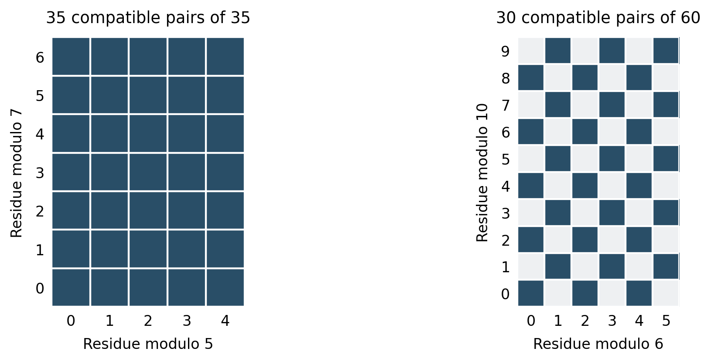

**Research white paper · Version 1.0**

# Abstract

CRAM can admit arbitrary positive target and sister moduli while retaining its fixed primary basis. The governing condition is exact observability from authentic source evidence, together with preservation of the declared phase and operation relations. Target coprimality is not required. This paper establishes that conclusion, explains the actual role of shared factors, and identifies the implementation obligations that remain separate from the arithmetic proof.

For a primary product $M$, write the semantic Euclidean decomposition $X=g+MK$, where $0\leq g<M$. A target modulus $b>0$ requires only the quotient coordinate $K\bmod h_b$, where $h_b=b/\gcd(M,b)$, together with the primary chart $g\bmod b$. An auxiliary modulus $A>0$, together with $g\bmod A$, exposes $K$ modulo $A/\gcd(M,A)$. Multiple authentic auxiliary observations combine by least common multiple. These statements hold for signed integers, composite moduli, and shared factors. The adjacent anchor $M+1$ is a particularly economical member of a larger affine family.

The fixed primary configuration is $\{2,3,5,7,11,13\}$, with product $30030$. Dependent sister views preserve the primary frame and can transport invariants through a specified representation relation. Their derivation does not automatically create independent information. A finite observation state answers a target exactly when that query is constant on the state's indistinguishable source classes, or when additional admissibility evidence selects the required representative.

The results are supported by elementary proofs, pinned CRAM and NINE65 sources, inspected historical Lean compilation receipts, and fresh exact integer checks. The paper distinguishes those forms of evidence from complete runtime conformance. It also corrects the unsupported identification of the architecture with a prime chain and gives a source-specific account of the roles of 11 and 23.

**Keywords:** CRAM; residue arithmetic; arbitrary moduli; generalized Chinese remainder theorem; dependent sister trays; exact observability; invariant transport.

# 1 The architectural question

The central question is whether downstream residue work must enlarge a pairwise coprime primary basis. The maintained architectural clarification answers a different, more general question: how can an unchanged primary frame support authentic, phase-related sister views and target queries over arbitrary positive moduli? The selected primary is fixed at six primes, with their assigned roles preserved. Sister moduli may overlap with the primary or with one another. Their admission depends on a defined source, phase relation, operation, and query contract. [1–3]

Throughout this paper, “fixed primary” refers to its configuration, modulus choices, and structural roles. Its source-dependent residue readings evolve during computation. A static basis does not mean static data. The symbol $K$ denotes a quotient in a proof or a requested quotient residue; it is not an instruction to retain an independent scalar winding ledger. Likewise, writing a canonical remainder $g$ in a theorem does not require a runtime to reconstruct that remainder as one wide integer. [1, 2]

Three mathematical questions have different answers.

| Question | Exact condition | Consequence |
|:--|:--|:--|
| Do common-source readings of all integers fill their full Cartesian product? | Their moduli are coprime | Full Cartesian CRT capacity |
| Can observations with shared factors describe the same integer? | Their residues agree on shared factors | A compatible state space with LCM period |
| Can the retained state answer a target query? | The query is constant on each observation class | Exact target output, without a target coprimality condition |

Confusing these questions produces the mistaken rule that every downstream modulus must be coprime to $30030$. That rule is appropriate for independent product capacity. It does not govern all observations, all sister relations, or all target projections. The generalized CRT and the query criterion below state the actual conditions.

The mathematical results here are primarily classical congruence arguments. The architectural contribution under examination is their organization around a fixed primary, source-bound dependent views, quotient queries on demand, and explicit operation contracts. This paper does not assert a priority claim for the underlying CRT identities, nor infer full implementation completion from those identities.

# 2 Semantic model and retained evidence

Let $M$ be a positive integer. For every signed integer $X$, Euclidean division gives

$$
X=g+MK,\qquad g=X\bmod M,\qquad 0\leq g<M,\qquad K=\lfloor X/M\rfloor.
$$

For the selected primary, $M=2\cdot3\cdot5\cdot7\cdot11\cdot13=30030$. The derivations remain valid for every positive primary product. All modular residues use least nonnegative representatives. A modulus of one is allowed mathematically and contributes only the zero observation.

| Symbol | Meaning |
|:--|:--|
| $X$ | Semantic source integer; not necessarily a scalar runtime object |
| $g$ | Canonical primary remainder, possibly represented implicitly by lanes |
| $K$ | Semantic quotient; a query may request only one residue of it |
| $A_i$ | Authentic auxiliary observation moduli |
| $b$ | Requested positive target modulus |
| $h_b$ | Minimal target quotient period $b/\gcd(M,b)$ |
| $H$ | Quotient resolution supplied by the retained auxiliary observations |
| $L$ | Total integer observation period $MH$ |

An authentic observation is a residue of the declared source at the declared phase. Two residues that happen to satisfy a congruence do not, by that fact alone, establish source provenance. A runtime needs the source and phase binding appropriate to its representation. Cryptographic authentication, where required, is an additional protocol property.

More generally, let $O:\mathcal D\to S$ map admissible sources into retained states. A requested observable $q:\mathcal D\to T$ is determined by that state precisely when there is a function $\widehat q$ on $O(\mathcal D)$ satisfying

$$
q=\widehat q\circ O.
$$

Equivalently, $O(x)=O(y)$ must imply $q(x)=q(y)$. Necessity follows by applying the same function to the same state. Sufficiency follows by assigning each observed state the common query value of its source class. This is an existence criterion, not a complexity bound or a runtime algorithm. It applies to scalar residue models and to richer heterogeneous source states. [2, 4]

# 3 Compatible residue geometry

## 3.1 Shared factors define compatibility

**Theorem 1.** Let $M,A>0$, $d=\gcd(M,A)$, and $L=\operatorname{lcm}(M,A)$. The common-source observation map induces a ring isomorphism

$$
\mathbb Z/L\mathbb Z\ \cong\
\{(r,a)\in\mathbb Z/M\mathbb Z\times\mathbb Z/A\mathbb Z:
r\equiv a\pmod d\}.
$$

**Proof.** Observations of one integer agree modulo $d$. Conversely, if $d$ divides $a-r$, write $M=dM'$ and $A=dH$. Since $\gcd(M',H)=1$, the congruence $M'k\equiv(a-r)/d\pmod H$ has a solution. Then $r+Mk$ realizes the pair. Two realizations differ by a multiple of both $M$ and $A$, hence by a multiple of $L$. Coordinatewise addition and multiplication respect the observation map. ∎

For a finite family of moduli, the same statement identifies the image of the integer observation map with $\mathbb Z/L\mathbb Z$, where $L$ is their LCM. Pairwise agreement modulo each shared GCD is necessary and sufficient for realizability. One proof selects, for each prime, the largest prime-power modulus present; pairwise agreement makes all smaller constraints consistent with it. Ordinary CRT then combines the constraints belonging to different primes.

The full Cartesian product is available exactly when the moduli are pairwise coprime. A shared factor reduces the number of freely assignable coordinate combinations; it does not invalidate compatible combinations.

{width=6.65in}

## 3.2 Added observations preserve existing distinctions

Appending an observation cannot erase the previous coordinates. Projection back to those coordinates recovers the original state. Consequently, two previously distinguishable sources remain distinguishable after an observation is appended, provided the original readings are retained correctly.

The incremental integer resolution from an auxiliary $A$ is

$$
\frac{\operatorname{lcm}(M,A)}{M}=\frac{A}{\gcd(M,A)}.
$$

For $M=30030$, adding modulus $4$ doubles the period to $60060$. The sources $0$ and $30030$ have the same primary readings but different residues modulo $4$, namely $0$ and $2$. Adding modulus $9$ triples the period; modulus $25$ multiplies it by five. A modulus dividing $M$, such as $6$, contributes a redundant observation. None of these cases destroys the primary information.

This capacity statement presumes an authentic additional source observation. If a sister is calculated deterministically from the already retained state, its graph has the same cardinality as that state. It may expose a useful interface, simplify a computation, or provide a consistency relation; it cannot manufacture distinctions absent from its input.

## 3.3 The orbit of one

Let $\rho$ denote a finite family of residue observations and let $e=\rho(1)$. Repeated addition of $e$ traverses exactly the compatible image of the integers, with period $L$. Thus the distinguished additive step “one” generates the full compatible integer orbit even when the raw product includes incompatible tuples. This is the precise orbit statement used in the related Theory of the One material. A stronger claim that one is uniquely selected by some different structural property requires that property to be specified. [4]

# 4 Projection into arbitrary target moduli

**Theorem 2.** Let $X=g+MK$ as above and let $b>0$. Define

$$
d_b=\gcd(M,b),\qquad h_b=b/d_b.
$$

Then the exact target residue is

$$
X\bmod b=
\bigl[(g\bmod b)+(M\bmod b)(K\bmod h_b)\bigr]\bmod b.
$$

No inverse modulo $b$, primality premise, or condition $\gcd(M,b)=1$ is required.

**Proof.** Write $K=qh_b+k$ with $k=K\bmod h_b$. Since $Mh_b=(M/d_b)b$, the term $Mqh_b$ vanishes modulo $b$. Substitution into $X=g+MK$ proves the formula. ∎

For fixed $g$, this is the least positive quotient period. In fact,

$$
M(K_1-K_2)\equiv0\pmod b
\quad\Longleftrightarrow\quad
h_b\mid(K_1-K_2).
$$

Therefore a quotient class $K\bmod t$ is sufficient for every possible $K$ exactly when $h_b\mid t$. Asking for $K\bmod b$ is always sufficient, but it may carry more quotient precision than the target needs. The target projection statements in the inspected Lean sources establish the no-coprimality result; this minimal-period formulation makes its information requirement explicit. [4, 5]

Several boundary cases are informative. If $b\mid M$, then $h_b=1$ and the target depends only on the primary remainder. For $M=1$, the remainder is zero and the target requires $K\bmod b=X\bmod b$. For $b=1$, the output is the unique zero residue. Signed $X$ needs no separate arithmetic rule because the decomposition is Euclidean.

The theorem specifies what a consumer needs. It does not by itself implement the producer of $g\bmod b$ or $K\bmod h_b$. In a strict residue-native runtime, both must come from permitted source-bound operations. Materializing a wide canonical remainder merely because it occurs in a proof is a separate design decision, and may violate the selected execution contract.

# 5 Quotient queries through arbitrary anchors

## 5.1 Exact common factor reduction

**Theorem 3.** Let $A>0$, $a=X\bmod A$, $d=\gcd(M,A)$, $H=A/d$, and $M'=M/d$. Define

$$
\Delta=(a-g)\bmod A.
$$

Then $d\mid\Delta$. Choose integers $u,v$ with $uM'+vH=1$. The pair $a$ and $g\bmod A$ determines

$$
K\bmod H=\left(u\,\frac{\Delta}{d}\right)\bmod H.
$$

**Proof.** The source identity gives $MK\equiv a-g\equiv\Delta\pmod A$. Since $d$ divides $M$ and $A$, it divides $\Delta$. Dividing the congruence by $d$ yields $M'K\equiv\Delta/d\pmod H$. Multiplication by $u$ completes the proof. ∎

For $H>1$, this is the usual multiplication by $(M/d)^{-1}\bmod H$. The Bézout form also covers $H=1$: the quotient observation then has only the zero class. The division by $d$ is an exact integer division of a known multiple, followed by inversion of a unit in the reduced modulus. It does not assume an inverse for a nonunit in the original ring. The inspected formal nonunit-query results use precisely certified common-factor reduction and a reduced inverse. [5]

Only $g\bmod A$ is needed to form $\Delta$; a full scalar $g$ is unnecessary for this identity. Whether that chart query has a conforming runtime producer remains part of the implementation contract.

## 5.2 The affine star family

**Theorem 4.** Let $c\in\mathbb Z$, and suppose the indicated anchor $A$ is positive. Then

$$
\begin{aligned}
A=cM+1&\quad\Longrightarrow\quad K\equiv c(g-a)\pmod A,\\
A=cM-1&\quad\Longrightarrow\quad K\equiv c(a-g)\pmod A.
\end{aligned}
$$

In both cases $\gcd(M,A)=1$.

**Proof.** Every common divisor of $M$ and $cM\pm1$ divides one. The congruence $MK\equiv a-g\pmod A$ can be multiplied by $c$. In the first case $cM\equiv-1$; in the second $cM\equiv1$. ∎

The adjacent anchor $A=M+1$ is the $c=1$ case, with readout $K\equiv g-a\pmod A$. Reversing that subtraction returns the negative quotient class. Its simplicity is valuable, but it is not the only construction with guaranteed coprimality. More generally,

$$
\gcd(M,cM+d)=\gcd(M,d).
$$

Nor does an anchor need to be prime. At the selected primary product, $30031=59\cdot509$ is composite and is still coprime to $30030$. The plus-family star theorem already appears in the maintained formal source. The minus-family case follows from the proof displayed here. [5]

## 5.3 Exact representatives from admissibility evidence

An anchor normally gives a quotient class, not an unbounded integer quotient. If $q=K\bmod H$ and the admissible quotient lies in $N$ consecutive integers beginning at $\ell$, where $1\leq N\leq H$, the candidate is

$$
K_* = \ell+((q-\ell)\bmod H).
$$

The query is accepted if $K_*<\ell+N$. There is at most one admissible quotient; when the observations are authentic and the interval promise holds, this candidate is the actual quotient. An interval is one sufficient admissibility condition. Other predicates may select a unique representative or determine a particular target without selecting the entire quotient. [4–6]

This distinction preserves the meaning of magnitude on demand. A semantic quotient may be identified when a consumer has adequate evidence. It need not become persistent scalar machine state.

# 6 Coupled observations and exact admission

## 6.1 Resolution combines by least common multiple

**Theorem 5.** Let $A_1,\ldots,A_t$ be positive auxiliary moduli carrying authentic observations of the same source. Define

$$
H_i=\frac{A_i}{\gcd(M,A_i)},\qquad
H=\operatorname{lcm}(H_1,\ldots,H_t).
$$

Let $O(X)=(X\bmod M,X\bmod A_1,\ldots,X\bmod A_t)$ include the primary reading. This observation tuple determines $K\bmod H$, and its total integer period is

$$
L=\operatorname{lcm}(M,A_1,\ldots,A_t)=MH.
$$

**Proof.** Theorem 3 determines each $K\bmod H_i$. Their compatibility is guaranteed by their common source, so generalized CRT determines the common class modulo $H$. Also, $A_i\mid Ms$ holds exactly when $H_i\mid s$. The least positive $s$ for which $Ms$ is divisible by every anchor is therefore $H$, giving the total period $MH$. ∎

For no auxiliary observations, use $H=1$ and $L=M$. Repeated anchors, and anchors already implied by the others, do not increase resolution. Equivalently, putting $C=\operatorname{lcm}(A_1,\ldots,A_t)$ gives $H=C/\gcd(M,C)$. This is the coupled-anchor law in the formal source and the source analysis titled Six. [6, 7]

The theorem describes the information available from a compatible family. It does not prescribe sequential scalar CRT reconstruction, Garner conversion, or any particular combining algorithm.

## 6.2 Necessary and sufficient target admission

**Theorem 6.** Under the finite observation model of Theorem 5, the query $X\mapsto X\bmod b$ is determined for every integer $X$ if and only if

$$
b\mid L\quad\Longleftrightarrow\quad b\mid MH
\quad\Longleftrightarrow\quad h_b\mid H.
$$

**Proof.** The observations identify precisely the classes modulo $L$. If $b\mid L$, equal observations imply equal target residues. Conversely, $0$ and $L$ have identical observations. Exact determination of their residues modulo $b$ forces $L\equiv0\pmod b$. Finally, divide $b\mid MH$ by $d_b=\gcd(M,b)$ and use $\gcd(M/d_b,b/d_b)=1$ to obtain $h_b\mid H$. ∎

The unrestricted integer quantifier matters. On a source domain with an authentic range or another admissibility constraint, a target may be determined even when $b$ does not divide $L$. A known interval of at most $L$ consecutive source integers supplies one familiar sufficient condition. The general test remains constancy of the query on each admissible observation class.

A fixed finite collection of residues cannot uniquely identify every integer. An extensible coherent family can supply additional precision as needed while leaving the primary frame unchanged. These are compatible statements. “Arbitrary modulus” specifies the permitted target domain; the evidence contract determines whether a particular request is currently answerable.

# 7 Dependent sisters and invariant transport

## 7.1 The representation relation

Let $S$ be the declared retained source state, including all authentic evidence required by its queries. A dependent sister is a well-defined view $\phi:S\to D$. Its valid joint states form the graph

$$
E(s)=(s,\phi(s)),\qquad G=E(S).
$$

The source projection $\pi:G\to S$ satisfies $\pi E=\operatorname{id}_S$. Thus $E$ is a bijection between $S$ and $G$. This definition makes a sister dependent without requiring it to be a function of one small primary snapshot alone. The richer retained source may carry evidence unavailable in that snapshot. [1–3]

**Theorem 7.** Let $F:S\to S$ be a source transition. Define the induced transition on valid joint states by

$$
\widetilde F(E(s))=E(F(s)).
$$

Then $\pi\widetilde F=F\pi$ on $G$. If $F$ is bijective, so is $\widetilde F$, with inverse $EF^{-1}\pi$. If $I:S\to V$ is invariant under $F$, then $\widetilde I=I\pi$ is invariant under $\widetilde F$.

**Proof.** Substitute $z=E(s)$ and use $\pi E(s)=s$. For the invariant, $\widetilde I(\widetilde F(E(s)))=I(F(s))=I(s)=\widetilde I(E(s))$. The inverse identity follows by the same substitution. ∎

For an implemented lane transition $T$, the decisive obligation is $T(E(s))=E(F(s))$. Naming a sister “phase-locked” is not a substitute for this equation. The relation must be initialized correctly and preserved by the actual transition. A more general relational specification can replace a functional view, but then its own existence, consistency, and transport obligations must be stated.

Transport concerns the specified state and invariant. It does not turn every composite residue ring into a field, make every divisor invertible, establish statistical independence, or prove independent scheduling. Those are distinct properties. Heterogeneous operators are permitted when the declared compatibility relation is preserved; they need not all be copies of a single scalar arithmetic operation.

## 7.2 A shared 11 interface

The source reconciliation gives a concrete dependent model with moduli $77=7\cdot11$ and $143=11\cdot13$:

$$
G_{11}=\{(a,b):a\bmod11=b\bmod11\},\qquad
|G_{11}|=1001=\operatorname{lcm}(77,143).
$$

This is a compatible subring of the raw product of $11011$ pairs. A common integer polynomial, for example $P(x)=x^2+3x+7$, preserves the shared modulo-11 relation. Reducing the same polynomial on each lane gives equal reductions modulo 11 whenever the inputs agree there. [3]

An arbitrary pair of unrelated updates need not preserve it. Starting at $(0,0)$, identity on the first lane and addition of one on the second produces $(0,1)$, which violates the shared interface. The point is an explicit operation law, not a blanket promise attached to the word “sister.”

Here $1001$ divides $30030$, so these views do not increase the integer observation period of the selected primary. They still supply useful factorizations and operator interfaces. This separates structural utility from extra independent capacity.

# 8 Worked source and target queries

## 8.1 Shared factor targets from the fixed primary

Take $M=30030$, $A=M+1=30031$, and a source admissibility promise $0\leq X<MA$. For $X=30047$, the primary remainder is $g=17$ and the anchor residue is $a=16$. The adjacent-star query returns $K\equiv17-16=1\pmod{30031}$. The stated range makes the actual quotient the representative $K=1$.

The consumer computes each target using Theorem 2. Several targets share factors with the primary.

| Target $b$ | $\gcd(M,b)$ | Required period $h_b$ | Exact $X\bmod b$ |
|--:|--:|--:|--:|
| 4 | 2 | 2 | 3 |
| 6 | 6 | 1 | 5 |
| 9 | 3 | 3 | 5 |
| 22 | 22 | 1 | 17 |
| 23 | 1 | 23 | 9 |
| 60 | 30 | 2 | 47 |
| 77 | 77 | 1 | 17 |
| 143 | 143 | 1 | 17 |
| 60060 | 30030 | 2 | 30047 |

For $b=60$, the computation is $(17+30\cdot1)\bmod60=47$. Only the parity of $K$ is needed. For $b=77$ or $143$, the quotient contributes nothing because the target divides $M$.

The admissibility promise is material. Without it, the pair $(g,a)$ identifies $X$ modulo $MA$, and some targets in the table do not divide $MA$. The same pair could then describe another source with a different target residue. The example demonstrates arbitrary target support from sufficient evidence, not universal identification from two finite readings.

## 8.2 A genuinely noncoprime anchor

Take $M=30$, $A=18$, and $X=77$. Then $g=17$, $a=5$, $d=6$, and $H=3$. The reduced defect is $\Delta=(5-17)\bmod18=6$, and $M/d=5$ has inverse $2$ modulo $3$. Hence $K\bmod3=2\cdot(6/6)\bmod3=2$, agreeing with $77=17+30\cdot2$.

This anchor resolves the quotient modulo three, and the total source period is $90$. It answers every target dividing $90$ on unrestricted integers. A target of $7$ needs additional evidence: $77$ and $167$ have the same observations modulo $30$ and $18$, but their residues modulo $7$ are $0$ and $6$.

## 8.3 The documented 2 and 11 relation

An earlier bounded sister-tray reference gives a specific relation, using $S$ for its source scalar:

$$
b_2=S\bmod2,\qquad
j_{11}=((S\bmod11)-b_2)\,6\bmod11.
$$

Because $2\cdot6\equiv1\pmod{11}$, it follows that

$$
S\equiv b_2+2j_{11}\pmod{22},\qquad
j_{11}=\lfloor S/2\rfloor\bmod11.
$$

Addition has an explicit cross-lane term. If $c_2=\lfloor(b_{2,L}+b_{2,R})/2\rfloor$, then

$$
j_{11,\mathrm{out}}=(j_{11,L}+j_{11,R}+c_2)\bmod11.
$$

This is a concrete phase and carry relation. Its two snapshots determine $S$ modulo $22$; arbitrary further queries depend on the richer retained source or additional admissibility evidence. The reference was an earlier bounded S8 experiment. It supplies evidence for this relation. The later fixed-primary clarification is applied here to the selected S6 profile; it does not justify replacing that primary with a proposed chain $2,5,11,23$. [1, 8]

# 9 The roles of 11 and 23

The roles assigned to particular primes require source-specific predicates. Numerical identities alone do not establish architectural necessity, provenance capacity, or a dynamics boundary.

The T SHADOW v2 source selects 11 from the candidate set $\{5,7,11\}$ using a declared family of periods: $260,365,584,780,399,378,11960,18980,819,116,30$. Five is excluded because it divides 260; seven because it divides 819; eleven divides none of those periods. The same source records $11960\bmod378=242=2\cdot11^2$ and a separate carry distinction over $\{7,11,13\}$. These are finite, specified tests. They do not prove that one modulo-11 lane can distinguish unbounded provenance histories. One incidental sentence in that source incorrectly says that five divides 584; the valid exclusion through 260 is sufficient and is the argument used here. [9]

The arithmetic relation $11=2\cdot5+1$ is true, as is $23=2\cdot11+1$. Neither proves that these are the intended first and second sisters. The proposed recurrence continues through 47 and then produces $95=5\cdot19$. Although $\gcd(47,95)=1$, the new value shares a factor with the accumulated chain. Coprimality with the immediately preceding value does not establish coprimality with all retained factors. A modulus constructed as $cM\pm1$ uses the relevant full product $M$; substituting just one member changes the claim.

The classical Ramanujan partition congruences include moduli 5, 7, and 11. Eleven is therefore not the smallest prime carrying a classical partition congruence. The historical distinction relevant to 11 is that Dyson's rank explains the 5 and 7 congruences but does not explain the 11 congruence; the crank addresses the full classical trio. These statements concern partition theory and require a specified bridge before they can determine a CRAM lane's operational role. [10, 11]

Likewise, 23 belongs to the exceptional prime set $2,3,5,7,23,691$ associated with Ramanujan's tau function in the cited literature. Membership in that set does not imply a computational instability threshold. A source example with the composite gear $667=23\cdot29$ instead uses the exact multiplicative orders $\operatorname{ord}_{23}(4)=11$ and $\operatorname{ord}_{29}(4)=14$, yielding order $154$ modulo 667. That is a defined orbit property. A claim of “turbulence” would need its own state space, evolution law, and measurable criterion. [12, 13]

The Maya Calendar Round illustrates compatible cycles: $\gcd(260,365)=5$ and $\operatorname{lcm}(260,365)=18980$. Its combined date repeats after 73 cycles of 260 days and 52 cycles of 365 days. The Tzolk'in combines 20 day names with 13 numbers; the Haab has eighteen 20-day periods plus five days. The mathematical analogy is a common-source compatibility constraint and an LCM period. It does not require treating the two calendars as coprime or asserting that a shared 20-day month structure explains their GCD. Historical interpretation remains distinct from the congruence model. [14]

# 10 Verification and implementation status

## 10.1 Evidence categories

The source review uses NINE65 revision `64c1c89b191093dc12cf81b87da5fb1a02c46dc1` and Theory of the One revision `b4c41726b28f224fc042280a4be2327b08e8365a`. The current architectural clarification, formal statements, historical experiments, and runtime code have different evidential roles.

| Evidence | Observed result | What it establishes |
|:--|:--|:--|
| Proofs in this paper | Explicit assumptions and derivations | Universal arithmetic conclusions under those assumptions |
| Maintained Lean sources and archived receipts | Matching source hashes; 28 integer and 19 coupled declarations | Inspected successful historical formal checks for the recorded source bytes |
| Fresh exact integer checks | 6,246,650 central checks passed | Finite corroboration across signed sources, shared factors, and bounded readouts |
| Pinned witness scripts | 50,000 projections; 48 star cases; compatible-sister enumeration | Additional finite regression evidence |
| Runtime source inspection | Arbitrary-target projection primitive present | Component support, with producer and full-path obligations still separate |

The maintained `IntegerSpecialization.lean` file matches the SHA-256 recorded in its successful 28-declaration audit. `CoupledAnchors.lean` matches the successful 19-declaration receipt. Those records use Lean 4.27.0-rc1 and report no admitted proofs or custom axioms; the listed dependencies are the standard foundational axioms `propext`, `Classical.choice`, and `Quot.sound`. This research inspected those sources and receipts. It did not freshly compile Lean or run a new Rust build. [5, 6, 15]

## 10.2 Fresh finite checks

The central exact integer sweep covers $M,A\in\{1,\ldots,40\}$ and $X\in\{-200,\ldots,200\}$ for 641,600 auxiliary quotient readouts. A second sweep covers $M\in\{1,\ldots,40\}$, the same signed sources, and $b\in\{1,\ldots,60\}$ for 962,400 target projections. A third checks bounded query-to-target recovery for $M,A,b\in\{1,\ldots,30\}$, every canonical primary remainder, and a complete signed quotient interval of length $A/\gcd(M,A)$, producing 4,642,650 target checks. All pass. The projection checks use the sufficient $K\bmod b$ form; the minimal $h_b$ requirement is proved in Theorem 2. The companion archive includes the executable sweep and its exact result receipt. These finite tests do not replace the proofs' universal quantifiers. [18]

The pinned arbitrary-moduli witness separately passes 50,000 sampled projections without coprimality filtering, 48 star-family cases, and 100 corrected adjacent-anchor sign cases. The dependent-sister probe examines all 11,011 raw pairs for moduli 77 and 143, finds exactly 1,001 compatible states, verifies all 1,001 common-polynomial updates, and rejects a mismatched update. [16]

## 10.3 The runtime boundary

The inspected Rust primitive `project_with_lift` rejects nonpositive targets and computes reduced multiplication followed by modular addition. It requires no inverse modulo the target and does not form the source integer or a scalar winding. Its correctness still depends on receiving the right source-bound remainder and lift residues. [17]

The surrounding `transduct_with_lift_provider` path calls `TransductionMap::apply`. The inspected implementation of that method forms a scalar sum of CRT idempotent contributions and a quotient used to correct the target readings. This internal CRT rank is distinct from the external source winding $K$, but its scalar aggregation means that the complete path does not establish the stronger no-internal-scalar-materialization contract. Absence of a Garner call alone does not establish that contract. This is an implementation-conformance finding, not a restriction on Theorem 2. [17]

To establish a fully conforming path, an implementation must identify its retained source state, bind each query to its source and phase, supply the exact required quotient coordinate, produce the canonical remainder's target view through permitted operations, and preserve each declared sister relation under transitions. It must also specify failure behavior when evidence is insufficient. These are concrete proof and implementation obligations; a different primary basis is not required to satisfy them.

# 11 Consequences for CRAM and adjacent domains

## 11.1 Demand specific precision

The quantity $h_b=b/\gcd(M,b)$ turns target admission into a precision question. A consumer requesting modulus 60 at $M=30030$ needs one bit of quotient information. A consumer requesting a divisor of the primary needs none. This can guide query planning and avoid requesting a full quotient when a smaller coordinate suffices. The information reduction is proved; execution savings depend on the actual producer, operator costs, and data movement.

Compatible auxiliary periods can expand available precision while retaining the primary frame. Repeated or divisor observations can serve interfaces or consistency checks without being miscounted as independent capacity. That distinction helps an implementation reason separately about representation, query cost, and transition correctness.

## 11.2 Cross domain applicability

The same mathematics applies to integer phase unwrapping, modular counters, and cycle synchronization when multiple readings refer to one underlying count. Shared-factor observations contribute LCM resolution, and exact decoding requires sufficient periods or a valid range. In physical sensing, calibration, noise, and source synchronization remain additional modeling requirements.

For multirate signal processing and modular scheduling, the framework distinguishes a full independent product from a compatible common-phase state. This can clarify period accounting and the conditions under which an output phase is determined. It does not, without a further dynamical model, establish stability or a signal-processing performance claim.

For formal verification, the graph construction gives a compositional route from a source invariant to a dependent view. The key engineering object is the commuting transition relation. This approach extends to heterogeneous representations whose lanes have different local operations, provided their joint relation is explicit and preserved.

In cryptographic or homomorphic settings, the target projection identity can support an arithmetic component of modular interoperability. A complete ciphertext conversion additionally needs a representation relation, permissible encrypted operations, correctness bounds, and the relevant security argument. Arithmetic validity alone establishes none of those protocol properties. The evidence in this paper concerns the stated arithmetic and inspected components.

A coherent family of finite residue observations also suggests an inverse-limit description: information is refined through compatible projections as more periods become available. This gives a mathematical language for extensibility without a fixed global period. Any finite implementation still has finite retained information and resource costs. The exact query criterion continues to apply at every finite stage.

## 11.3 Architectural conclusion

The fixed-primary architecture can support arbitrary positive moduli through authentic dependent observations and exact quotient queries. Shared factors determine compatibility and resolution; they do not impose a universal ban on downstream moduli. The primary need not be replaced by a speculative prime chain, and a quotient used in a proof need not become a stored scalar ledger.

The decisive contract is concrete: a requested target must factor through the retained source evidence, and each transition must preserve the declared representation relation. This contract accommodates both the arithmetic generality and the structural hierarchy of the architecture. It also states exactly what a complete implementation must demonstrate.

# Appendix A Corrections to the disputed interpretation

| Disputed statement | Correct statement |
|:--|:--|
| Every added modulus must be coprime to 30030 | Coprimality is necessary for full independent product capacity; compatible observations and arbitrary targets have different conditions |
| A shared factor causes information loss | Appending a valid observation preserves old distinctions; incremental resolution is reduced to $A/\gcd(M,A)$ |
| The adjacent anchor is the unique construction with automatic coprimality | Every positive $cM+1$ and $cM-1$ is coprime to $M$ |
| A phase lock is defined by one affine modulus formula | An actual source, phase, and operation relation must be specified; affine anchors are useful arithmetic constructions |
| Eleven is justified as the first sister in a prime chain | The sources contain specific finite selection criteria, shared interfaces, and a 2/11 carry relation; the proposed chain is unsupported |
| Twenty three marks a universal smoothness boundary | A boundary needs a defined dynamic invariant; cited orbit and tau properties do not supply it |
| Arbitrary target support gives every target from any finite residue snapshot | A target must be constant on observation classes or be resolved by additional admissibility evidence |
| Formal arithmetic establishes complete runtime conformance | Universal proofs, archived formal builds, finite tests, and inspected runtime components support different claims |

# Appendix B Formal source correspondence

The correspondence below identifies supporting declarations. The paper's formulations may combine or strengthen the presentation of several source statements; this is not a claim that every displayed theorem has been freshly formalized under the paper's numbering.

| Paper result | Relevant source declarations |
|:--|:--|
| Arbitrary target projection | `target_projection_of_decomposition`; `target_projection_of_period_dvd` |
| Auxiliary quotient readout | `query_quotient_congruence`; `nonunit_query_of_decomposition`; `nonunit_chart_query` |
| Affine star family with $A=cM+1$ | `star_inverse_certificate`; `star_query_congruence` |
| Coupled observation resolution | `combined_kernel`; `source_period`; `resolution_eq_lcm_reduced` |
| Exact target admission | `combined_target_iff`; `main_and_anchor_readings_iff` |
| Admissible representative selection | `query_exact_signed_window`; `signed_window_unique` |
| Dependent observations | `dependent_anchor_resolution`; written invariant-transport proof in the reconciliation |

The integer file is in namespace `KElimination.IntegerSpecialization`; the coupled file is in `KElimination.CoupledAnchors`. The inspected audit hashes are recorded below in four consecutive groups of sixteen hexadecimal characters per file. Concatenating the groups recovers each SHA-256 digest. [15]

**IntegerSpecialization**

`c7788921b59a7244` `e54d53cf1bda2013` `e3bacea98b9392b2` `9c67b1fe91a3fa88`

**CoupledAnchors**

`4357100f2e4b0632` `d36c1e16cfcaa5da` `10fe2285a8029773` `aa1b2112a8b9e95d`

# References

All repository links below are pinned to the reviewed revisions. Drive materials are cited as source documents, with historical claims qualified in the body. Access reviewed 19 November 2026.

**[1]** NINE65. [Fixed primary and sister trays](https://github.com/Skyelabz210/NINE65_v7/blob/64c1c89b191093dc12cf81b87da5fb1a02c46dc1/docs/proofs/cram/FIXED_PRIMARY_SISTER_TRAYS_2026-11-17.md). Architectural clarification dated 17 November 2026.

**[2]** NINE65. [CRAM core specification](https://github.com/Skyelabz210/NINE65_v7/blob/64c1c89b191093dc12cf81b87da5fb1a02c46dc1/lean4/CRAMUniversal/docs/cram/CORE_SPEC.md), especially the distinctions among independent carriers, dependent observations, query admission, and invariant transport.

**[3]** NINE65. [Prime Family reconciliation](https://github.com/Skyelabz210/NINE65_v7/blob/64c1c89b191093dc12cf81b87da5fb1a02c46dc1/docs/proofs/cram/PRIME_FAMILY_RECONCILIATION_2026-11-17.md). Written invariant-transport argument and compatible moduli 77 and 143 example.

**[4]** Diaz research materials. [Theory of the One](https://github.com/Skyelabz210/Theory-of-the-One/blob/b4c41726b28f224fc042280a4be2327b08e8365a/foundations/theory_of_the_one/theory_of_the_one.md). Reviewed revision `b4c41726b28f224fc042280a4be2327b08e8365a`; orbit, observability, arbitrary-anchor, and minimal target-quotient arguments.

**[5]** NINE65. [IntegerSpecialization.lean](https://github.com/Skyelabz210/NINE65_v7/blob/64c1c89b191093dc12cf81b87da5fb1a02c46dc1/lean4/CRAMUniversal/KElimination/UniversalResearch/IntegerSpecialization.lean). Maintained Lean declarations for star inverses, signed quotient readout, nonunit reduction, and target projection.

**[6]** NINE65. [CoupledAnchors.lean](https://github.com/Skyelabz210/NINE65_v7/blob/64c1c89b191093dc12cf81b87da5fb1a02c46dc1/lean4/CRAMUniversal/KElimination/UniversalResearch/CoupledAnchors.lean). Maintained Lean declarations for coupled periods, dependent anchors, and target observability.

**[7]** Diaz research materials. [Six](https://docs.google.com/document/d/11r0sPZU_WZXxIOzy93G2I6nJD1hSV5yOEeCRL-Fh1HQ). Source analysis covering noncoprime anchors and the coupled-anchor law. See also [Cram sept 2](https://docs.google.com/document/d/12GQ2rmQUi7v5vj3qMmTZeifmORs16nuRrRyEbwpOxHg) for source, target, operation, and relation distinctions.

**[8]** NINE65. [Safe Basis sister trays](https://github.com/Skyelabz210/NINE65_v7/blob/64c1c89b191093dc12cf81b87da5fb1a02c46dc1/docs/execution/2026-10-19/SAFE_BASIS_SISTER_TRAYS.md). Earlier bounded S8 reference experiment, including the 2/11 relation and parity-crossing carry. Its profile differs from the S6 profile selected for this paper; [1] supplies the later fixed-primary clarification.

**[9]** Diaz research materials. [T SHADOW v2](https://docs.google.com/document/d/1qgwyLjH_r4zuDn7Daatb96O-_bvB2gD7/edit?usp=drivesdk). Written finite candidate and period analysis. Cited as a source argument, not as a freshly compiled formal proof.

**[10]** Garvan, F. G. “New combinatorial interpretations of Ramanujan's partition congruences mod 5, 7 and 11.” *Transactions of the American Mathematical Society* 305 (1988), 47–77. [Author abstract](https://qseries.org/fgarvan/abstracts/crank.html).

**[11]** Andrews, G. E., and Garvan, F. G. “Dyson's crank of a partition.” *Bulletin of the American Mathematical Society* 18 (1988), 167–171. [Author abstract](https://qseries.org/fgarvan/abstracts/dysoncrank.html).

**[12]** Ciolan, A., Languasco, A., and Moree, P. *Landau and Ramanujan approximations for divisor sums and coefficients of cusp forms*. Max Planck Institute for Mathematics preprint 2021-46, especially the discussion of exceptional primes for tau. [Preprint](https://archive.mpim-bonn.mpg.de/id/eprint/4656/1/mpim-preprint_2021-46.pdf).

**[13]** Diaz research materials. [Composite Gear](https://docs.google.com/document/d/1pZCfjnimVV1F7iDtXQCm57JuxxWID5-q5UELoi-jrdk). Used here only for the specified multiplicative-order example. Older carried-winding language is not adopted.

**[14]** Smithsonian National Museum of the American Indian. [The Calendar System](https://maya.nmai.si.edu/calendar/calendar-system). Calendar components and the 18,980-day Calendar Round.

**[15]** NINE65. Archived formal verification receipts: [integer axiom audit](https://github.com/Skyelabz210/NINE65_v7/blob/64c1c89b191093dc12cf81b87da5fb1a02c46dc1/docs/proofs/cram/collection/universal-theorem/integer-axiom-audit.json), [integer build log](https://github.com/Skyelabz210/NINE65_v7/blob/64c1c89b191093dc12cf81b87da5fb1a02c46dc1/docs/proofs/cram/collection/universal-theorem/integer-build.log), [coupled result](https://github.com/Skyelabz210/NINE65_v7/blob/64c1c89b191093dc12cf81b87da5fb1a02c46dc1/docs/proofs/cram/collection/universal-theorem/coupled-result.json), and [coupled build log](https://github.com/Skyelabz210/NINE65_v7/blob/64c1c89b191093dc12cf81b87da5fb1a02c46dc1/docs/proofs/cram/collection/universal-theorem/coupled-build.log). Inspected historical receipts matching the source digests in Appendix B.

**[16]** NINE65. [Arbitrary-moduli witness](https://github.com/Skyelabz210/NINE65_v7/blob/64c1c89b191093dc12cf81b87da5fb1a02c46dc1/scripts/witness_arbitrary_moduli_claims.py) and [dependent-sister probe](https://github.com/Skyelabz210/NINE65_v7/blob/64c1c89b191093dc12cf81b87da5fb1a02c46dc1/docs/proofs/cram/clarification-evidence-2026-11-17/dependent_sister_probe.py). Pinned source copies executed for this review; finite checks described in Section 10.

**[17]** NINE65. [Lifted transduction](https://github.com/Skyelabz210/NINE65_v7/blob/64c1c89b191093dc12cf81b87da5fb1a02c46dc1/crates/exact_transcendentals/src/lifted_transduction.rs) and [transduction implementation](https://github.com/Skyelabz210/NINE65_v7/blob/64c1c89b191093dc12cf81b87da5fb1a02c46dc1/crates/exact_transcendentals/src/transduction.rs). Inspected projection primitive and full-path scalar aggregate, respectively.

**[18]** Companion reproduction archive, `Arbitrary_Moduli_in_CRAM_reproduction.zip`, supplied with this white paper. Includes `verify_arbitrary_moduli.py`, `results.json`, the manuscript source, pinned witness copies and execution receipts, and a README with exact file hashes and reproduction instructions. Central sweep executed with Python 3.12.14; 6,246,650 cases, zero failures.

**Preparation note.** This white paper was prepared with AI assistance from the cited source materials and independent arithmetic review. It is a research synthesis with explicit proofs and evidence boundaries; no external peer-review status is claimed.
