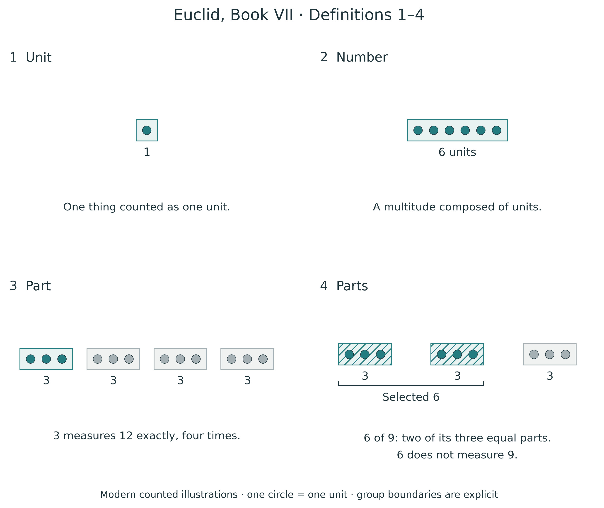
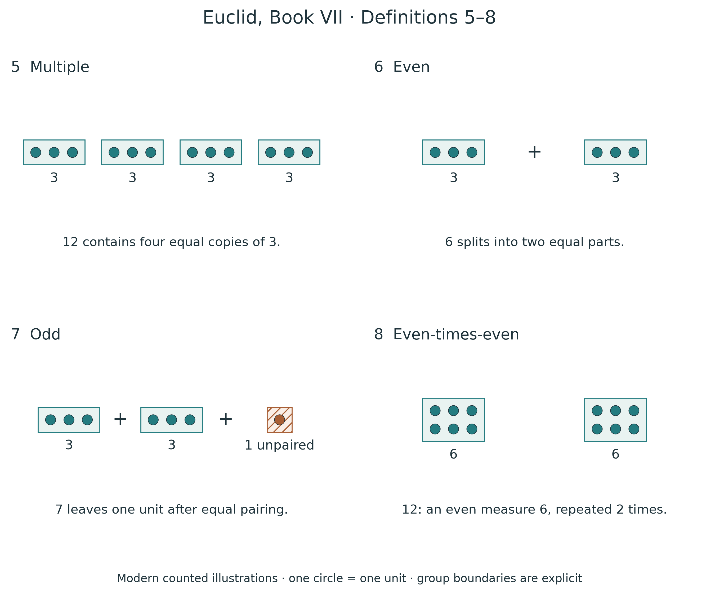
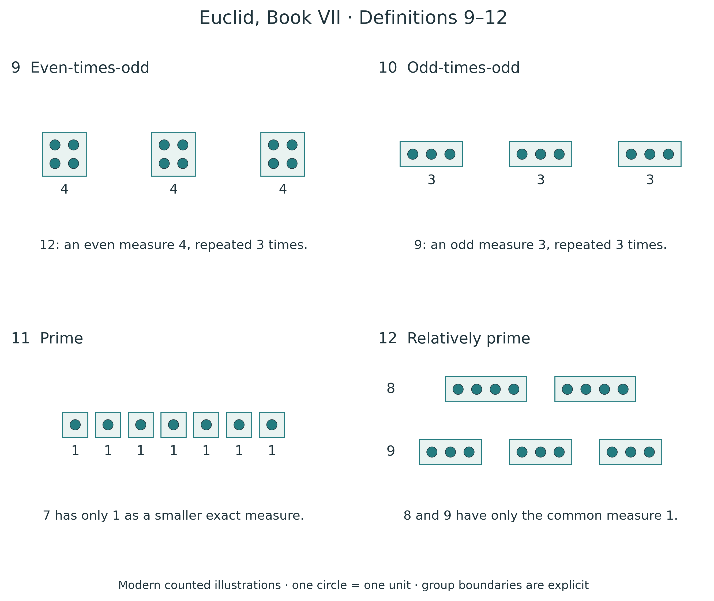
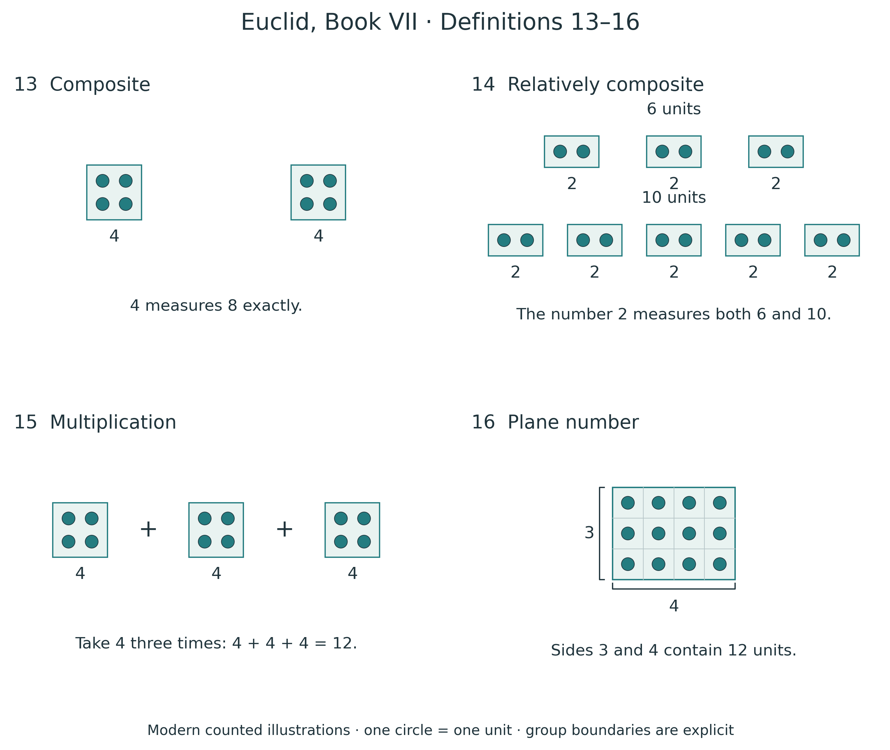
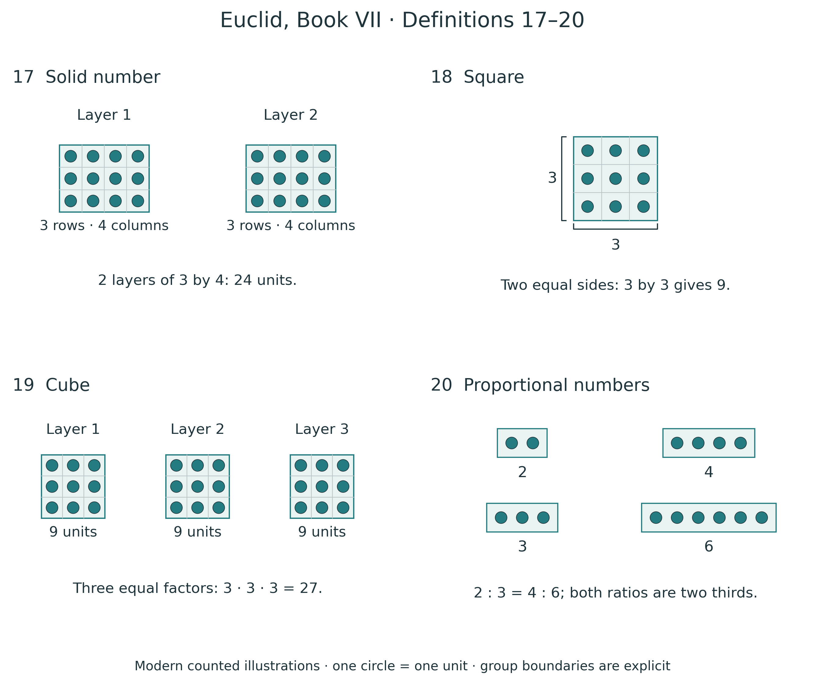
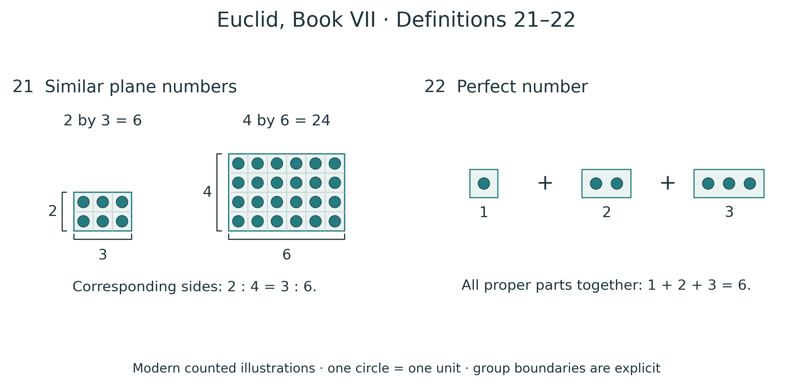
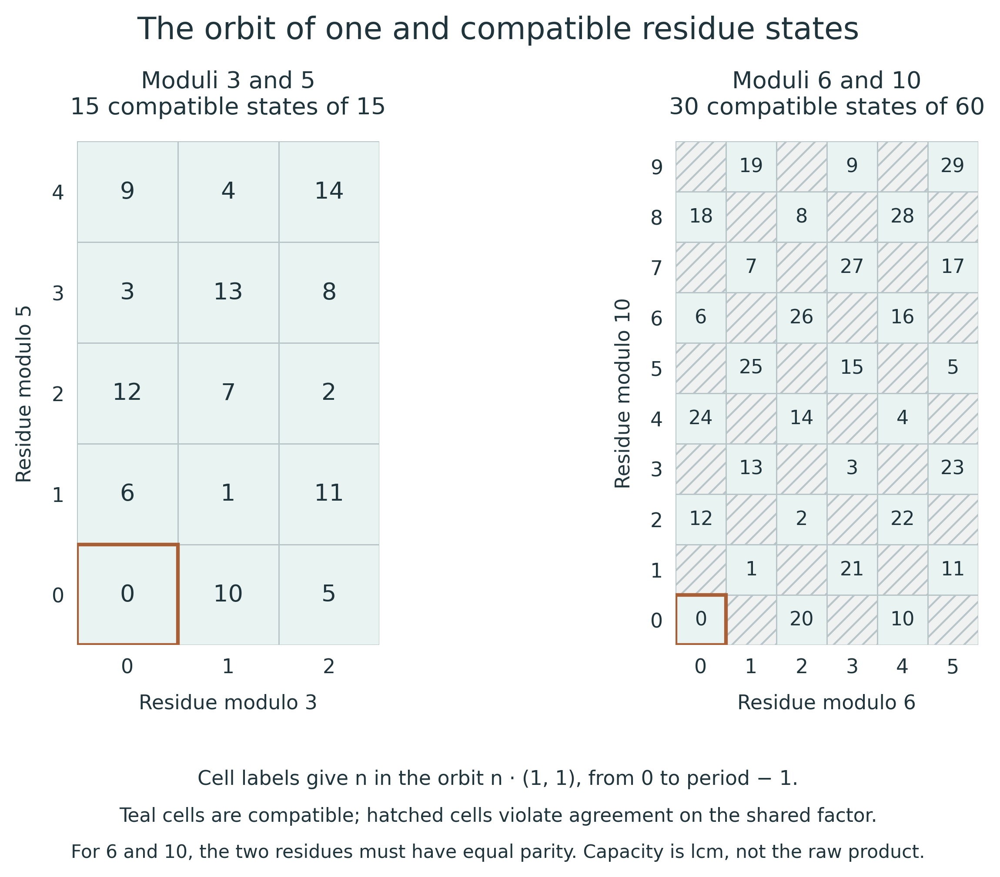
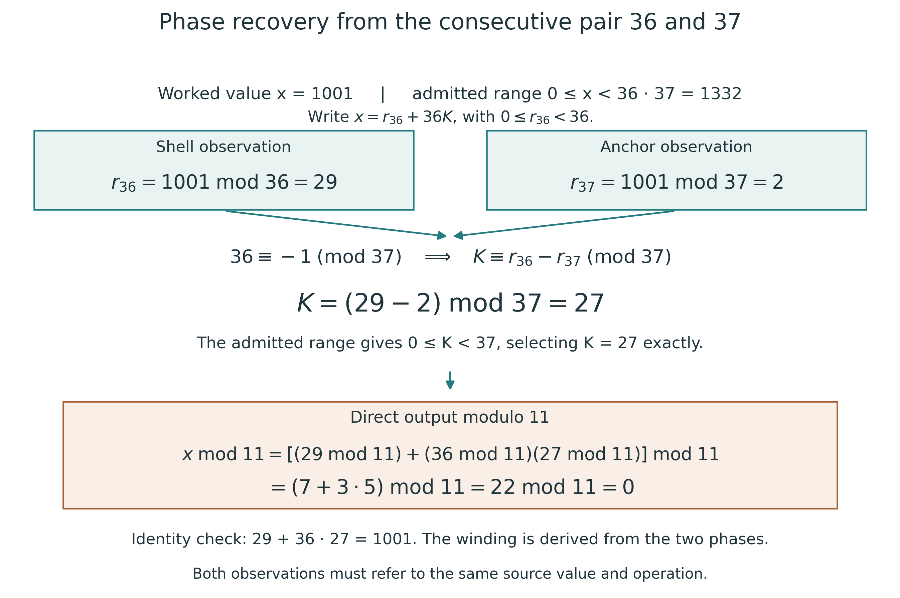

# Abstract

Theory of the One develops the consequences of Euclid’s account of unity, number, and measurement for exact computation. It begins with the definitions as written and develops explicit mathematical derivations. CRAM is the configurable machine architecture developed from that foundation, with applications connected to NINE65, QMNF, MANA, discrete numerical analysis, signal processing, and archeo-mathematical research. A chosen One generates compatible finite residue states, while coordinated observations and explicit admission conditions determine which further arithmetic facts can be recovered from those states.

Fourteen theorem sections establish the unit orbit, compatibility of overlapping views, exact observation of winding, the information required for target projection, carry identities, signed comparison, quotient recovery with shared factors, typed heterogeneous operations, reversible computation, representation equivalence, and coherent refinement. The central implementation principle is magnitude on demand: a quotient or integer value may be observed when an operation needs it, without requiring a persistent scalar winding field. A compositional exactness theorem states the conditions under which this common arithmetic foundation supports multiple applications.

The draft distinguishes established algebra, written proofs developed here, inspected formal source, compiled formal results, executed finite checks, and open research claims. On 16 November 2026 the pinned universal Lean package passed a fresh audit of 130 theorem declarations, and its concrete executable checks passed 1,809 comparison/divmod/GCD pairs plus four controls. The reproducible integer-only Python checker passed 821,881 assertions with zero failures. The [formal coverage map](../../docs/reviews/2026-11-16-formal-coverage.md) identifies which manuscript statements these results cover; the fourteen theorem sections are not fourteen fully formalized theorems. All 22 Book VII definitions appear in their selected order, with counted-unit illustrations, the supplied English rendering, and an edition-identified Greek appendix.

The resulting contribution is a precise, source-grounded formulation of the research program and its proof obligations. Historical interpretation, implementation performance, cryptographic claims, and continuum physics require their own evidence beyond the arithmetic foundation.

# Reading this draft

This is Anthony Diaz’s working thesis, prepared with AI assistance from his supplied text and research sources. Its method starts with Euclid’s statements as written and develops their consequences through explicit definitions and proofs. Source quotations retain their wording and edition attribution; derived propositions state their premises; CRAM specifies the machine design that realizes the results.

The author clarified this framing on 15 November 2026. The 16 November verification review updates evidence descriptions and clarifies storage wording; it preserves the theorem statements, proofs, English and Greek appendices, and mathematical source code. The external repository inspections retain the dates and scopes recorded in Appendix D and source_versions.json. Fresh execution of the included universal Lean package is indexed in [evidence status](../../evidence/STATUS.md).

The mathematical proofs use semantic integers to say what a state means. Writing an integer $x$ or a quotient $K$ in a proof does not prescribe storing or reconstructing that quantity during computation. An implementation may carry coordinated residue observations and derive only the observable required at an operation boundary.

The draft uses six evidence descriptions consistently:

| Description | Meaning |
|---|---|
| Established algebra | A standard mathematical result, with attribution and an explicit argument where needed. |
| Written proof | A mathematical derivation supplied in this draft; formalization status is recorded separately. |
| Formal source inspected | A specific theorem declaration and its source were read at an identified commit. |
| Compiled formal result | A stated declaration was checked with the pinned Lean compiler; its premises and axiom dependencies remain part of the claim. |
| Executed reference check | The accompanying mathematical checker was run on a stated finite domain. |
| Open research claim | A proposed interpretation or implementation property that needs further evidence. |

The current CRAM claim policy reserves its capitalized verification label for an actually compiled Lean or Coq artifact. The original 11 November external-source study inspected the standalone bounded K-Elimination source without rerunning it. The 16 November review freshly compiled this repository's distinct universal package: 130 declarations, 30 with no axiom dependencies and the remainder using only `propext`, `Classical.choice` and `Quot.sound`. The coverage map preserves the distinction between those checked statements and the remaining written proofs. [R2, R3]

# 1. The research proposition

## 1.1 The common question

The repositories suggest a common question: how much exact arithmetic can be carried out while the operative state remains a coordinated collection of residue observations, and how can operations recover magnitude, quotient, comparison, or a new representation when those observables are needed?

The question is about the structure of computation and its contracts. It is meaningful even when the underlying congruences are classical. A mathematical identity specifies what information is sufficient; an architecture determines where that information lives, how it remains tied to the intended computation, and which observations an operation is permitted to expose.

The external CRAM reference inspected on 11 November provides a concrete lineage example. Its state records small-lane observations, a shell residue, an anchor residue, and a bound. Its winding property is computed from the phase relation between shell and anchor. There is no persistent scalar $K$ field in that inspected state definition. Its exact-value bound needs separate conformance review against the current machine contract; absence of a K field alone does not settle that question. The reference also exposes the integer through a declared value-reading method. [R1]

## 1.2 Proposed central thesis

**Compatible residue observations can serve as the primary state of an exact arithmetic system. The One generates its coherent finite scalar states; authentic phase information and certified domains supply additional observables on demand; and typed operations preserve meaning across changes of representation and across applications.**

This formulation has three separately assessable parts. The first is algebraic: it characterizes the orbit generated by one. The second is informational: it states exactly what observations and qualifications determine an output. The third is compositional: it requires each implemented operation to preserve a declared semantic relation.

The intended architectural contribution is the organization of these facts into a common computational foundation. A claim of mathematical priority would additionally require a systematic comparison with prior residue arithmetic literature. This draft provides an initial comparison and does not make a priority claim.

## 1.3 Relation to earlier residue arithmetic

The Chinese remainder theorem and division with remainder are established foundations. Earlier RNS literature also studies magnitude comparison, ordinary quotient/remainder algorithms, dual bases, and base extension. Hung and Parhami’s 1994 paper explicitly treats ordinary division by fixed divisors; its first method does not require the divisor to be coprime to every modulus. Bajard, Didier, and Kornerup’s 2001 paper develops modular multiplication with two residue bases and discusses the information needed by different base-extension routes. [M1, M2, M4, M5]

The thesis therefore compares precise operation contracts. An identity shared with CRT does not establish that two implementations use the same data flow. Conversely, a different data flow does not make every supporting congruence a new theorem. Useful comparison criteria are the carried state, source of auxiliary observations, range discipline, generated intermediate values, arithmetic cost model, and permitted output observations.

The current NINE65 integration contract permits declared reconstruction when semantics require it and excludes Garner or mixed-radix synthetic emissions in residue computation. Those are current project requirements. They should not be replaced with a stronger blanket prohibition on every integer observation. [R4]

# 2. Euclid’s order: from the unit to the perfect number

## 2.1 Textual and mathematical conventions

The chosen sequence is the 22-definition sequence of Book VII used by the author’s English passage. The anomalous label “13a (14)” is normalized to Definition 14. Appendix A preserves the complete supplied English wording. Appendix B gives the Greek of Heiberg’s edition as reproduced in Fitzpatrick’s corrected 2008 edition, with editorial brackets retained. This is an identified edition of the transmitted text, rather than a claim to reproduce an autograph. [E1, E2]

The illustrations in this chapter are modern explanatory constructions. They follow the order and arithmetic relations of the definitions. Counted units and segmented lengths make the quantities inspectable. Layer arrays represent solid numbers without hiding units in perspective. The residue-space derivations follow afterward, with their definitions and hypotheses stated separately from the quoted text.

Three uses of “unit” need separate names. Euclid’s counting unit makes a thing one. The diagonal residue identity is the image of that chosen one in every observed modulus. A ring-theoretic unit is any element that has a multiplicative inverse. The last class can contain many elements. For example, modulo five, the classes of one, two, three, and four are all invertible.

In the Book VII convention used here, a number is a multitude of units, so the factors called numbers are greater than one. Modern zero, signed integers, residue classes, and inverse limits are explicit extensions of that starting point. A foundational role for one does not make one prime. A modulus-one coordinate has only one state and adds no distinguishable capacity.

## 2.2 Definitions 1–4: one, multitude, part, and parts

Definition 1 fixes the unit. Definition 2 forms a number by collecting units. Definition 3 then asks whether a smaller number measures a larger one exactly: three measures twelve four times. Definition 4’s plural “parts” describes the other relation: six is two thirds of nine. It is not another name for the remainder of a division.

If $2\leq a<b$ and $g=\gcd(a,b)$, the fraction $a/b$ reduces to $(a/g)/(b/g)$. When $a$ measures $b$, its reduced numerator is one. Otherwise the numerator exceeds one. This is a modern way to explain the distinction while preserving the historical order.

## 2.3 Definitions 5–8: multiple, even, odd, even-times-even

Definition 5 reads the measurement relation from the greater number: twelve is a multiple of three. Definitions 6 and 7 distinguish equal bisection from a unit difference. Definition 8 concerns a factorization into two even numbers. For positive integers, this is equivalent to divisibility by four.

This gives an early observation test for the thesis. The six-prime basis $(2,3,5,7,11,13)$ has period 30030. It determines parity, but its observations alone do not determine divisibility by four for an unrestricted integer: $12$ and $30042$ have the same six residues and different residues modulo four. A genuine modulo-four observation, an informative anchor, or a valid uniqueness domain can supply the distinction.

## 2.4 Definitions 9–12: factor parity, prime, relatively prime

Definition 9 requires an even factor and an odd number greater than one. Definition 10 requires two odd factors greater than one. Thus odd-times-odd describes odd composite numbers. Definitions 8 and 9 can overlap: twelve is both $2\cdot6$ and $4\cdot3$. They are not an exclusive three-way partition with Definition 10.

Definition 11 concerns an individual number’s proper measures. Definition 12 concerns a common measure of two numbers; eight and nine are relatively prime although neither is prime. An invertible residue modulo a chosen base records coprimality to that base. It does not establish integer primality: $289=17^2$ is invertible in all six of the listed prime lanes.

## 2.5 Definitions 13–16: composition and multiplication

Definition 13 is witnessed by a nontrivial factorization. Definition 14 is witnessed by a common factor greater than one. Definition 15 defines multiplication through exactly the specified number of summands. In the supplied wording “added to itself,” three times four means three copies of four, with total twelve.

Definition 16 retains the two factors as the sides of a plane number. The factorization is meaningful information: the integer twelve can have sides two and six or three and four. A product residue alone need not identify which sides were intended.

## 2.6 Definitions 17–20: solid, square, cube, proportion

Definitions 17–19 retain three factors or impose equality on two or three factors. A square or cube residue witness is a modular statement unless the integer root is also qualified. For example, six is a square modulo five, but six is not an integer square.

For Definition 20, positive-number proportion admits the exact modern criterion

$$
a:b=c:d \quad\Longleftrightarrow\quad ad=bc.
$$

This avoids modular division by a possible nonunit. If all observed residues of $ad-bc$ vanish, they establish divisibility of that difference by the observation period. An exact lift, or a certified bound such as $|ad-bc|<L$, then establishes equality. The cross-product characterization is also the subject of Euclid VII.19. [E2]

## 2.7 Definitions 21–22: similar numbers and perfection

Similarity requires proportional corresponding sides, so the chosen factorizations must be retained. The plate shows plane numbers with sides $(2,3)$ and $(4,6)$. For solid numbers, the cubes with sides $(2,2,2)$ and $(3,3,3)$ have all three corresponding side ratios equal to two thirds. Equality or proportionality of totals alone does not specify those side correspondences.

Perfection requires both a complete proper-divisor list and exact equality with its sum. For six, the complete list is one, two, and three, and their sum is six. A congruent sum from an incomplete list would not establish the definition. This final definition returns to the unit through a structured collection of parts.

# 3. The One and coherent residue states

## 3.1 Definitions

Let $B=(m_1,\ldots,m_n)$, with $n\geq1$ and $m_i\geq2$. Composite moduli and repeated moduli are allowed. Define

$$
P_B=\prod_{i=1}^{n}\mathbb Z/m_i\mathbb Z,
\qquad L_B=\operatorname{lcm}(m_1,\ldots,m_n).
$$

The simultaneous residue map and its diagonal one are

$$
\rho_B(x)=(x\bmod m_i)_i,\qquad e_B=\rho_B(1).
$$

Write $C_B=\rho_B(\mathbb Z)$ for the compatible scalar states. The raw product $P_B$ and its compatible part $C_B$ are different objects when moduli overlap. An application may choose either as its state type, but its value semantics must say which.

More generally, in any unital ring the map sending an integer $n$ to $n\cdot1$ preserves addition and multiplication. Repeated addition proves the positive-integer identities; additive inverses extend them to signed integers. This places the generative role of one in a standard algebraic setting.

## Theorem 1. The orbit of the One

The additive orbit $\{k e_B:k\in\mathbb Z\}$ has exact period $L_B$. It consists precisely of tuples satisfying

$$
r_i\equiv r_j\pmod{\gcd(m_i,m_j)}
\quad\text{for every }i,j.
$$

Moreover,

$$
C_B\cong\mathbb Z/L_B\mathbb Z,
$$

and $C_B=P_B$ exactly when the moduli are pairwise coprime.

**Proof.** A multiple $k e_B$ is zero exactly when every $m_i$ divides $k$, equivalently when $L_B$ divides $k$. Thus the residue map has kernel $L_B\mathbb Z$, and its image has exactly $L_B$ elements. Its preservation of addition and multiplication gives the displayed ring isomorphism.

Every image tuple satisfies the pairwise conditions because each common divisor divides the difference of two remainders of the same integer.

For the converse, factor $L_B$ into its maximal prime powers. For each $p^a\mid L_B$, choose a lane containing that full power and prescribe the value modulo $p^a$ using its residue. Pairwise compatibility ensures agreement with every other lane modulo the power of $p$ that lane contains. The maximal prime-power moduli are mutually coprime, so Bézout’s identity combines their prescriptions into an integer. That integer has every required lane residue.

Finally, the raw product has $\prod_i m_i$ elements. This equals $L_B$ exactly when no prime occurs in two distinct moduli, which is pairwise coprimality. ∎

This identifies the unit orbit through generalized CRT; the underlying existence and compatibility facts are classical. [M1]

**Capacity example.** The observations modulo six, ten, and fifteen resolve an integer modulo thirty, although their raw product has nine hundred elements. Their overlaps constrain compatibility. Those views can still be operationally useful; they should be counted by their LCM when measuring scalar resolution.

## Theorem 2. Which observations are determined?

Let $L,q$ be positive integers. For unrestricted integer $x$, knowing $x\bmod L$ determines $x\bmod q$ for every $x$ if and only if $q\mid L$. More generally, an observable $f(x)$ is a function of $x\bmod L$ exactly when

$$
f(x+L)=f(x)\quad\text{for every integer }x.
$$

**Proof.** If $q\mid L$, two representatives differing by a multiple of $L$ have the same residue modulo $q$. If $q\nmid L$, the integers zero and $L$ have the same observed residue and different target residues. For a general observable, being constant on each residue class is exactly periodicity by $L$. ∎

**Consequences.** A universal $d$-divisibility predicate is available from this observation alone exactly when $d\mid L$. The positive integers $d$ and $d+L$ prove the necessity. An individual state can sometimes rule divisibility out with less information: oddness already excludes divisibility by four.

If an observed difference $D$ is zero modulo $L$ and $|D|<L$, then $D=0$, because no other multiple of $L$ lies in that interval. This is an exact-equality rule for proportions and other arithmetic invariants.

The theorem describes the stated observation alone. It leaves room for additional authentic views, bounds, operation history, or other qualified state to distinguish otherwise identical classes.

# 4. Phase relations and magnitude on demand

## 4.1 What an anchor supplies

Let $M,A\geq2$, and let $r=x\bmod M$ and $s=x\bmod A$ be observations of the same semantic integer. Here “authentic” means actually derived from the same declared value and operation; it does not assert a cryptographic authentication protocol. Euclidean division defines

$$
x=r+MK,\qquad 0\leq r<M.
$$

The integer $K$ is winding relative to this shell. It depends on the shell modulus. It is not an invariant scalar attached to every possible representation of $x$.

The anchor relation gives information about $K$. Its resolution follows from the overlap of $M$ and $A$. The current coprime CRAM route is a special case of the next theorem. The shared-factor extension here is algebraic and is not asserted to be the current API’s accepted input contract.

## Theorem 3. Anchor-observed winding

Let $g=\gcd(M,A)$ and $H=A/g$. Authentic observations satisfy $g\mid(s-r)$. If $H>1$, then

$$
K\equiv
\frac{s-r}{g}\left(\frac{M}{g}\right)^{-1}
\pmod H.
$$

When $H=1$, the anchor supplies no further winding distinction. A pair $(r,s)$ has an integer witness exactly when $g\mid(s-r)$.

**Proof.** Reducing $x=r+MK$ modulo $A$ gives $MK\equiv s-r\pmod A$. The common divisor $g$ must divide the right side. Dividing the congruence by $g$ leaves a coefficient $M/g$ coprime to the reduced modulus $H$, so its inverse exists when $H>1$. Conversely, any solution of the reduced congruence produces an integer satisfying both observations. When $H=1$, compatibility is the whole condition. ∎

### Exact recovery from a certified interval

Suppose the true $K$ is known to lie among the $N$ consecutive integers

$$
a\leq K<a+N,\qquad 1\leq N\leq H.
$$

For the recovered class $\kappa$, form

$$
K_* = a+((\kappa-a)\bmod H).
$$

Accept this candidate exactly when $K_*<a+N$. It is the unique candidate in the interval, because distinct representatives of a class modulo $H$ differ by at least $H$. Authentic observations and a valid interval guarantee acceptance and equality with the actual $K$.

For coprime $M,A$, the familiar bound $0\leq x<MA$ implies $0\leq K<A$. It therefore turns the phase congruence into exact natural-number winding recovery. A bound must be supplied by a valid input or update invariant; a test oracle’s knowledge of $x$ is not a substitute for a production invariant.

### Adjacent and star-family anchors

When $A=M+1$, the coefficient $M$ is $-1$ modulo $A$, giving

$$
\kappa=(r-s)\bmod A.
$$

For the more general star construction $A=cM+1$, with positive integer $c$,

$$
M(A-c)\equiv1\pmod A.
$$

Indeed $-cM=1-A$. The inverse can therefore be derived directly from the frame construction. Primality of $A$ is unnecessary for this inverse role. The inspected B6 reference uses $M=30030$ and composite $A=30031=59\cdot509$. [R1]

**Worked example.** With $M=36$, $A=37$, and $x=1001$, the residues are $r=29$ and $s=2$. The derived class is $27$. The domain $0\leq x<1332$ selects that exact winding. Thus $29+36\cdot27=1001$, and direct reduction modulo eleven gives zero.

If the domain qualification is removed, $x+1332$ has the same observations and a winding greater by thirty-seven. The phase observations retain exactly their stated resolution.

### Source binding is a separate premise

Coprime residue pairs are always algebraically solvable. They can therefore be consistent with some integer while being unrelated to the intended operation. For example, combine the shell residue $7\bmod5=2$ with the anchor residue $12\bmod7=5$. The pair denotes twelve modulo thirty-five; it does not denote the intended value seven.

A source or operation label helps only when the update mechanism enforces its meaning. Each carried observation must be produced from the same declared inputs and semantic operation. This premise is central to the architecture and is not established by the phase equation alone.

## Theorem 4. The exact winding resolution a target needs

For target modulus $q\geq2$, put

$$
h_q=\frac{q}{\gcd(M,q)}.
$$

Knowing $r$ and $K\bmod h_q$ suffices for

$$
x\bmod q=
\left(r\bmod q+(M\bmod q)(K\bmod h_q)\right)\bmod q.
$$

An observation $K\bmod H$ determines this target for every $K$ exactly when $h_q\mid H$.

**Proof.** Set $d=\gcd(M,q)$, so $M=dM'$ and $q=dh_q$ with $\gcd(M',h_q)=1$. Changing $K$ by $h_q$ changes $MK$ by a multiple of $q$. More generally, changing $K$ by $H$ preserves the target exactly when $q\mid MH$, equivalently $h_q\mid H$. If this divisibility fails, the candidates $K=0$ and $K=H$ already give different targets. ∎

For the anchor in Theorem 3, $MH=\operatorname{lcm}(M,A)$. Thus its winding class alone supports every target modulus dividing that LCM. Other target residues can be derived after sufficient additional qualification selects an exact $K$.

The distinction has operational value. A target often needs only a class of winding rather than the exact integer K. Keeping qualifying residue evidence and deriving K on demand avoids a persistent scalar winding register. For fixed M, the pair (r,K) and x determine one another; this is a claim about carried state and requested observables, not information compression. The formula above forms only reduced target operands and does not require constructing $r+MK$ as a complete scalar.

For example, the 36/37 frame supports a target modulo seventy-four directly from $K\bmod37$, because $74/\gcd(36,74)=37$. A target modulo ten needs $K\bmod5$; a class modulo thirty-seven alone does not determine it. The certified interval from the worked example supplies the additional qualification.

# 5. Arithmetic, carry, order, and sign

## Theorem 5. Carry is an exact cocycle

For canonical residues $0\leq r,s,t<M$, define

$$
r\oplus s=(r+s)\bmod M,\qquad
c_M(r,s)=\frac{r+s-(r\oplus s)}{M}.
$$

The carry belongs to $\{0,1\}$ and satisfies

$$
c_M(r,s)+c_M(r\oplus s,t)
=c_M(s,t)+c_M(r,s\oplus t).
$$

Both sides equal $\lfloor(r+s+t)/M\rfloor$. For signed integers $x=MK+r$ and $y=MJ+s$,

$$
K_M(x+y)=K+J+c_M(r,s).
$$

**Proof.** The sum $r+s$ lies between zero and $2M-2$, so the carry is zero or one. Expand either two-stage carry sum using the definition. The intermediate representative cancels, leaving the total sum minus its canonical remainder, divided by $M$. Substituting the Euclidean decompositions of $x$ and $y$ yields the final identity. ∎

The corresponding product and negation identities are

$$
K_M(xy)=MKJ+Ks+Jr+\left\lfloor\frac{rs}{M}\right\rfloor,
\qquad r_M(xy)=rs\bmod M,
$$

and

$$
K_M(-x)=-K-\mathbf{1}_{r>0}.
$$

The negative remainder is zero if $r=0$, and otherwise $M-r$. Expand the product for the multiplication formula; borrow one shell when negating a nonzero remainder.

These identities describe exact semantic winding whether it is stored or derived. They also correct an overly simple preservation claim: at shell size five, four and three each have winding zero, while their sum has winding one. A proof of winding preservation must include this carry or justify its absence on the chosen domain.

## Theorem 6. Order from transient lift coordinates

For canonical decompositions $x=MK+r$ and $y=MJ+s$,

$$
x<y\quad\Longleftrightarrow\quad
(K,r)<_{\mathrm{lex}}(J,s).
$$

Also, $x<0$ exactly when $K<0$, and $x=0$ exactly when $K=0$ and $r=0$.

**Proof.** If $K=J$, comparison reduces to $r<s$. If $K<J$, then

$$
x\leq MK+M-1<M(K+1)\leq MJ\leq y.
$$

Interchanging the roles gives the reverse case. If $K<0$, then $x\leq-M+(M-1)<0$; if $K\geq0$, both terms in $x=MK+r$ are nonnegative. Uniqueness of division gives the zero condition. ∎

This comparison rule applies once valid phase and domain information has selected the needed lift coordinates. They may be temporary. The current Python reference accepts nonnegative values; the signed theorem here is a mathematical extension, not a claim that its current input API already supports negative integers.

Exact arithmetic and probabilistic properties are also separate. A logically reversible update need not produce an independent sequence of carries. Any IID, detailed-balance, or statistical claim needs its specified probability space and transition law.

# 6. Exact division, including shared factors

## 6.1 Three division contracts

The word division covers different operations:

| Operation | Required information | Result |
|---|---|---|
| Modular inversion | $\gcd(d,m)=1$ | Multiplication by $d^{-1}$ in $\mathbb Z/m\mathbb Z$. |
| Euclidean division | $d>0$, plus sufficient dividend information | Unique integers $q,\rho$ with $x=dq+\rho$ and $0\leq\rho<d$. |
| Rational division | Nonzero denominator and an exact rational representation | The rational number $x/d$. |

When $x=dq+\rho$ and $d$ is invertible modulo $m$, the quotient satisfies

$$
q\bmod m=((x\bmod m)-\rho)d^{-1}\bmod m.
$$

Without remainder correction, inverse multiplication gives $q$ modulo $m$ exactly when $\rho\equiv0\pmod m$; in particular it is valid for exact division, where $\rho=0$. Subtracting the known remainder gives the correct quotient residue in every admitted inverse lane.

Shared factors prevent that inverse route in the affected lane. They do not prevent every exact quotient method. The next two theorems state sufficient and exact information conditions independently of a particular implementation.

## Theorem 7. Quotient residues from a coefficient witness

Let $d\geq1$, $m\geq2$, and $x=dq+\rho$, where $0\leq\rho<d$. If an authentic observation supplies

$$
t=x\bmod(dm),
$$

then

$$
q\bmod m=\frac{t-\rho}{d}.
$$

The right side is an exact integer in $[0,m)$.

**Proof.** Since $d\mid dm$, the canonical representative $t$ has the same remainder $\rho$ modulo $d$ as $x$. Write it uniquely as $t=dq_0+\rho$, with $0\leq q_0<m$. The difference $x-t$ is a multiple of $dm$, so $q-q_0$ is a multiple of $m$. Therefore $q_0=q\bmod m$. This argument uses canonical remainders and works for negative dividends as well. ∎

The theorem assumes access to its larger-modulus witness. It does not manufacture that information from a smaller observation that aliases distinct quotients. The Euclidean division foundation is standard. [M2]

## Theorem 8. Exact information required for a quotient residue

Fix $d\geq1$, $m\geq2$, $N\geq1$, and a known remainder $0\leq\rho<d$. Among inputs $x=dq+\rho$, an observation $x\bmod N$ determines $q\bmod m$ for every integer $q$ exactly when

$$
m\mid\frac{N}{\gcd(N,d)}.
$$

**Proof.** Two quotients $q,q'$ give the same observed dividend precisely when $N\mid d(q-q')$. Let $g=\gcd(N,d)$. Cancellation and coprimality make this equivalent to $N/g\mid(q-q')$. Thus the observation resolves the quotient modulo $N/g$. Its fibers determine a target class modulo $m$ exactly when $m\mid N/g$, by Theorem 2. ∎

### Valuation-matched recovery

For a prime-power target $m=p^\alpha$, write the divisor as $d=p^t u$ with $p\nmid u$. An authentic observation of $(x-\rho)\bmod p^{\alpha+t}$ suffices:

$$
q\bmod p^\alpha=
\left(\frac{(x-\rho)\bmod p^{\alpha+t}}{p^t}\right)
u^{-1}\bmod p^\alpha.
$$

The numerator is divisible by $p^t$. Dividing removes the noninvertible prime-power factor; the remaining factor $u$ is inverted in the target ring. Theorem 8 also gives necessity: an observation modulus used alone for every quotient must contain at least that much $p$-power precision.

For a general target, decompose it into prime powers, use the required precision for each, and combine the compatible target observations. This is a mathematical route; a production interface must specify where the witnesses originate.

### Worked shared-factor example

Take $x=30$, $d=6$, and target $m=8$. The true quotient is five with remainder zero. The witness modulo forty-eight from Theorem 7 is sufficient. A sharper witness is modulo sixteen:

$$
30\bmod16=14,\qquad 14/2=7,\qquad
7\cdot3^{-1}\equiv7\cdot3\equiv5\pmod8.
$$

Modulo eight alone is insufficient. The dividends zero and twenty-four are both multiples of six and both zero modulo eight, but their quotients are zero and four modulo eight. The missing distinction is information that an auxiliary observation, valid range, or another declared representation must supply.

### Corrected example from the author’s working notes

For $500=7\cdot71+3$, the dividend residues modulo seven, eleven, and thirteen are $(3,5,6)$. The quotient residues in the surviving inverse lanes are

$$
(5-3)\cdot7^{-1}\equiv2\cdot8\equiv5\pmod{11},
$$

$$
(6-3)\cdot7^{-1}\equiv3\cdot2\equiv6\pmod{13}.
$$

The value eight modulo eleven is the inverse of seven, not the quotient residue. The corrected quotient observations are five and six. This repair preserves the intended method and makes the worked example agree with the integer quotient seventy-one. [N1]

## 6.2 Application to current operation routes

The current NINE65 contract describes separate routes: bounded K-Elimination division, auxiliary handling for shared-factor divisors, and division over encrypted bit words. Each has its own domain, witness, and output semantics. Their shared use of the word division does not make them interchangeable. [R4]

The inspected residue-divider reference uses bounded scalar reconstruction and ordinary quotient/remainder. Its source calls it a reference projector and records a conflict with its trait’s no-full-reconstruction wording. The present draft therefore treats it as evidence for a reference operation and certificate structure, rather than as evidence that the separate auxiliary production route has been verified here. [R5]

# 7. Typed operators and reversible computation

## Theorem 9. Heterogeneous outputs require declared semantics

Suppose each lane applies a declared operation $F_i$ to its lane inputs. For pairwise-coprime carriers, every resulting tuple has a unique class in $\mathbb Z/L_B\mathbb Z$. For overlapping carriers, it has such a scalar-coherent interpretation exactly when its outputs satisfy the pairwise compatibility conditions of Theorem 1.

Even when a scalar class exists, the induced operation need not be ordinary integer addition or multiplication.

**Proof.** The existence and uniqueness claims follow from Theorem 1. For the semantic distinction, use carriers two and three with inputs $x=y=1$. Adding in the first lane and multiplying in the second produces $(0,1)$, the class four modulo six. Ordinary addition produces two, and multiplication produces one.

For the overlap condition, use carriers four and six with the same inputs and operations. The output $(2,1)$ has inconsistent parity, so no integer satisfies both observations. ∎

The inconsistent tuple remains an element of the raw product. A broader state theory may admit it with a non-scalar meaning. In the inspected current CRAM lineage, heterogeneous outputs have their own operation semantics and a single-integer read must not be silently imposed. The CRT existence observation above does not authorize an integer observation forbidden by the chosen state type. [R2]

If each of $n$ lanes has $k$ operation labels, then $k^n$ counts assignments of labels. Distinct assignments may define the same function: addition and subtraction coincide modulo two, and squaring is the identity there. Claims about the number of distinct operators need a semantic equivalence relation and a declared input domain.

## Theorem 10. Reversibility needs a domain or retained information

On $\mathbb Z/m\mathbb Z$, multiplication by $d$ is bijective exactly when $\gcd(d,m)=1$. For any function $f$ and an additive output group, the retained-input update

$$
T(x,y,z)=(x,y,z+f(x,y))
$$

is bijective. For fixed positive $d$, Euclidean division with remainder is a bijection

$$
\mathbb Z\longrightarrow\mathbb Z\times\{0,\ldots,d-1\},
\qquad x\longmapsto(q,\rho).
$$

**Proof.** If $d$ has a modular inverse, multiplying by it inverts the first operation. Otherwise, with $g=\gcd(d,m)>1$, the distinct residues zero and $m/g$ have the same product with $d$.

The retained-input update has inverse $(x,y,z')\mapsto(x,y,z'-f(x,y))$. For division, existence and uniqueness of quotient and remainder give the bijection, with inverse $(q,\rho)\mapsto dq+\rho$. ∎

A nonzero fixed multiplier can also be injective on a restricted integer domain whose outputs remain admitted, even when its modular action on the whole residue ring is not bijective. Exact division restricted to multiples of $d$ is reversible onto its quotient image. A quotient operation on arbitrary integers that discards the remainder generally is not.

These statements let the thesis specify what is preserved. They avoid attaching one blanket reversibility claim to addition with discarded inputs, multiplication by zero, value-preserving transduction, and deliberate quotient projection.

# 8. Representation, capacity, and coherent growth

## Theorem 11. Enriched states have a value quotient

Let $S_{\mathrm{adm}}$ be admitted records containing their basis, qualified observations, and any relevant bound, topology, or lineage metadata. Assume each record has a unique semantic integer value, and define

$$
V=\operatorname{Val}(S_{\mathrm{adm}}),\qquad
s\sim t\ \Longleftrightarrow\
\operatorname{Val}(s)=\operatorname{Val}(t).
$$

Then $[s]\mapsto\operatorname{Val}(s)$ is a bijection

$$
S_{\mathrm{adm}}/{\sim}\ \longrightarrow V.
$$

If total addition and multiplication maps on $S_{\mathrm{adm}}$ preserve ordinary values, they descend to this quotient. If $V=\mathbb Z$, the quotient with those operations is isomorphic to the integer ring.

**Proof.** Equality of values is an equivalence relation. The quotient map is well-defined and injective by definition, and surjective because $V$ is the image. For equivalent inputs $s\sim s'$ and $t\sim t'$, value preservation gives

$$
\operatorname{Val}(\operatorname{Add}(s,t))
=\operatorname{Val}(s)+\operatorname{Val}(t)
=\operatorname{Val}(\operatorname{Add}(s',t')).
$$

Multiplication is identical in form. Thus the result class is independent of the representatives, and the bijection preserves the ring operations when its image is all integers. ∎

Different bases can represent the same value. A value-one record on basis $(2,3)$ and one on $(5,7)$ need not be the same record. The quotient expresses their shared value while allowing their implementation metadata to remain distinct.

The current bounded APIs are partial: an operation can reject an output outside its certified range. The quotient-ring conclusion applies only under its stated totality and closure hypotheses. A growing family of qualified representations can support a larger value domain, but that growth must be supplied by actual state and operations.

## 8.1 Value-preserving transduction

Let $E_B(x)$ and $E_D(x)$ be qualified encodings on two bases. On their common admitted domain, define a transduction by the requirement

$$
\operatorname{Val}_D(T_{B\to D}(E_B(x)))=x.
$$

A round trip preserves the value. It need not reproduce every historical or audit field bit for bit unless that is part of the contract. Likewise, homogeneous addition commutes with transduction when all intermediate results remain admitted:

$$
\operatorname{Val}_D(T_{B\to D}(s+t))
=\operatorname{Val}_D(T_{B\to D}(s)+T_{B\to D}(t)).
$$

Both sides equal $\operatorname{Val}_B(s)+\operatorname{Val}_B(t)$.

The inspected reference transduction explicitly obtains $x=r_M+KM$, checks target capacity, and re-encodes it. That is a declared scalar observation using the linear shell identity. The direct target theorem in Chapter 4 gives a different possible contract that computes only needed residues. The thesis distinguishes the mathematical alternatives from the route actually implemented in the reference. [R1]

## 8.2 How much a new view adds

If current compatible observations resolve $x$ modulo $L$, adding an authentic observation modulo $q$ changes the resolution to

$$
L'=\operatorname{lcm}(L,q),\qquad
\frac{L'}{L}=\frac{q}{\gcd(L,q)}.
$$

This follows directly from Theorem 1. A repeated view contributes no new scalar capacity. A higher prime power may add precision even though it is dependent on an existing prime lane.

For B6, adding a second modulo-thirteen view contributes a factor of one. Adding modulo twenty-five contributes a factor of five; adding modulo nine contributes three. An authentic modulo-$11^6$ view contributes $11^5$, because one factor of eleven is already present. Adding the coprime anchor 30031 contributes that full factor, giving combined period 901830930.

The current source contains both B6 and S8 contexts. They are kept distinct:

| Basis | Moduli | Shell period |
|---|---|---:|
| B6 | $2,3,5,7,11,13$ | 30030 |
| S8 | $2,3,5,7,11,13,17,19$ | 9699690 |

The current NINE65 contract assigns roles to its S8 lanes. Those role assignments are part of that implementation’s design. They are not an algebraic theorem that these primes are the unique possible basis. Prime fields can be required by a transform operation, while ring or inverse operations have different modulus conditions. [R4]

## Theorem 12. Direction and additive reversal

On $C_B$, let $T_+(r)=r+e_B$, $T_-(r)=r-e_B$, and $N(r)=-r$. Then

$$
NT_+N=T_-.
$$

If $L_B>1$, the finite additive group has no translation-invariant total order.

**Proof.** Substitution gives $N(-r+e_B)=r-e_B$. For the order claim, if $0<e_B$, translation invariance would imply

$$
0<e_B<2e_B<\cdots<L_Be_B=0,
$$

a contradiction. If $e_B<0$, apply the same argument to its negative. ∎

Negation here is an additive-group automorphism; it is not generally a unital ring automorphism. Selecting successor gives a chosen arithmetic direction. A physical time interpretation needs a specified dynamics and empirical bridge. Ordinary integer comparison can be recovered from qualified lifts as in Theorem 6.

## Theorem 13. Coherent refinement and the completion

For positive integers ordered by divisibility, define

$$
\widehat{\mathbb Z}=
\left\{(a_n)_n:
a_n\in\mathbb Z/n\mathbb Z,\
a_n\bmod m=a_m\ \text{whenever }m\mid n\right\}.
$$

The map $\mathbb Z\to\widehat{\mathbb Z}$ taking an integer to all its residues is injective. Its image is dense in the inverse-limit topology, but is not the whole completion.

**Proof of injectivity.** If two integers have all residues equal, every positive integer divides their difference. A modulus greater than the absolute difference forces the difference to vanish.

**Proof of density.** A basic open set specifies finitely many coordinates of a compatible family. Theorem 1 supplies an integer meeting those congruences. Hence every nonempty basic open set meets the integer image.

**Proof that the image is proper.** For each $n=2^a u$ with $u$ odd, prescribe a residue that is zero modulo $2^a$ and one modulo $u$. CRT gives a unique class modulo $n$, and those classes agree under all reductions. If the family came from an integer $z$, divisibility by every power of two would force $z=0$. But the condition modulo three would require $z\equiv1\pmod3$, a contradiction. ∎

This family is a nontrivial idempotent: every coordinate satisfies $a_n^2=a_n$. The ordinary integers have only the idempotents zero and one. The example therefore exhibits an exact extra kind of state in the completed residue space.

This is the standard profinite completion. The One generates each finite compatible quotient; its integer multiples are dense in the completion. The completion and the ordinary integer orbit are distinct, and the profinite topology is not the usual real-line topology. [M3]

For an executable architecture, arbitrary refinement additionally needs an effective method that obtains each requested observation, establishes consistency, and accounts for resources. Fixed finite observations do not gain new capacity solely through a change of terminology.

# 9. The shared foundation across the projects

## Theorem 14. Compositional exactness

For each declared type $T$, let $S_T$ be its admitted machine states, $V_T$ its semantic values, and $\operatorname{Val}_T:S_T\to V_T$ its value map. The value type may be integer, rational, or an explicitly defined heterogeneous state.

An implemented operation $G$ exactly realizes semantic operation $g$ on its admitted domain when

$$
\operatorname{Val}_U(G(s_1,\ldots,s_k))
=g(\operatorname{Val}_{T_1}(s_1),\ldots,
\operatorname{Val}_{T_k}(s_k)).
$$

Compositions of such operations are exact wherever their successive admission conditions hold. If an iteration’s invariant preserves those conditions, machine and semantic executions agree at every finite step.

**Proof.** Substitute the first operation’s value equation into the second’s. Repeating this substitution establishes the result for a finite expression tree or computation graph. For iteration, the input invariant gives the base case. The next operation’s exactness equation and invariant preservation give the induction step. ∎

This theorem provides a precise statement of the shared foundation across projects. A common substrate can discharge recurring arithmetic obligations once, and applications can add their own typed semantic bridges. The theorem does not establish those bridges merely because the coefficient arithmetic is exact.

## 9.1 Repository lineage inspected on 11 November 2026

The original GitHub connection exposed 41 Skyelabz210 repositories. That focused review inspected contracts or source in the nine repositories below at the commits recorded in Appendix D. Other visible repositories were discovered but were not all audited. The 16 November review checks the files included in Theory-of-the-One; it does not refresh these external repository assessments.

| Project | Contribution to this thesis | Evidence boundary |
|---|---|---|
| cram-substrate | Current paired-view state, derived winding, guarded arithmetic, star frames, transduction. | Concrete reference source inspected; full repository audit not rerun. |
| k-elimination-lean4 | Bounded natural-number winding soundness formalization. | Specific complete source inspected; no fresh Lean build. |
| NINE65_v7 | Current basis roles, operation contracts, provenance, division and integration routes. | Contracts and selected implementation paths inspected. |
| NINE65-Rust-Guide | Earlier explanatory lineage. | Requested current contract path absent at observed head; not the integration authority. |
| QMNF_System | Earlier primary/reference-view formulation and PLMG lineage. | Some inspected formal files contain proof holes; broad proof labels are not adopted. |
| MANA-definitive | Application lineage; NINE65 inventory identifies the MANA anchor implementation. | Performance and security claims were not re-established. |
| NS-Regularity | Exact discrete conservation application and a finite formal target. | Its continuum interpretation has separate obligations. |
| cram-dsp | Exact band-index recovery applied to image or signal data. | Physical or material calibration is a separate empirical layer. |
| dccms | Owner-attributed archeo-mathematical program and an explicit evidence register. | Historical manuscript interpretation remains separately testable. |

## 9.2 The external reference model at its inspected commit

At the inspected commit, the CRAM reference stores its shell and anchor observations and derives winding when requested. Its constructor admits $0\leq x<MA$. Arithmetic updates the observations componentwise, while bound propagation guards the admitted domain. That reference also stores a bound initially equal to the supplied value. Such a bound carries exact scalar magnitude at ingress and needs review against the current contract forbidding a concealed scalar payload. This is an observation about the dated source description, not a fresh external implementation audit. The included Lean core instead uses public frame capacity and a two-field residue state. [R1]

The source formalization in the standalone Lean repository states natural-number soundness with $X<MA$ and an explicit modular-inverse witness. Its phase expression reduces the shell residue modulo the anchor before natural-number subtraction. That detail avoids a truncating-subtraction error when $M>A$. The theorem is evidence for the bounded coprime case at its recorded commit. This repository's newly checked universal package separately covers signed query identities, conditional nonunit queries, coupled-anchor kernels and target criteria; the coverage map identifies the remaining gaps, including the full valuation-derived quotient route. [R3]

## 9.3 Discrete analysis and signal processing

The inspected NS-Regularity source declares an exact discrete skew-advection energy-neutrality result by composing component residual lemmas. This is a relevant application of exact arithmetic and compositional proof. Establishing a continuum regularity theorem additionally requires a justified relation between the discrete state, limiting construction, and continuum solution. That bridge was not verified by this review. [R8]

CRAM-DSP provides a particularly clear example of typed interpretation. Its P4 result concerns the exact arithmetic band index $\lfloor L/M\rfloor$ for a measured integer luminance quantity. The source separates this calculation from pigment or material calibration. The quotient observation can be proved algebraically; the physical label attached to a band requires empirical evidence. [R9]

## 9.4 Archeo-mathematics and the Dresden hypothesis

The dccms thesis identifies the Dresden interpretation as the author’s research hypothesis and distinguishes arithmetic identities from manuscript observations and unmeasured correlations. This attribution is preserved here. [R6]

Examples of exact identities relevant to that program include

$$
13\cdot20=260,\qquad18\cdot20+5=365,
\qquad\operatorname{lcm}(260,365)=18980,
$$

$$
37960=65\cdot584=104\cdot365=146\cdot260,
$$

and $7592=13\cdot584$, with $7592\bmod11=2$.

Their arithmetic can be checked independently. Identifying the proposed computation in a manuscript requires a separately documented mapping from primary images to quantities and operations, including rules fixed before the outcome is measured and alternative explanations. An arithmetic identity alone does not establish its historical use.

Euclid and the Dresden research have distinct roles in this thesis. Euclid supplies the starting statements on unity, measurement, factors, proportion, and completeness, whose consequences are developed in the mathematical sections. The author’s Dresden work supplies an attributed line of investigation into coordinated periodic observations. CRAM realizes the arithmetic results through explicitly specified representations and operations, evaluated against their mathematical and implementation contracts.

# 10. Claim register and the next proof obligations

## 10.1 What this draft establishes

| Claim | Present evidence |
|---|---|
| The diagonal One generates compatible finite scalar states. | Written proof of Theorem 1; classical algebra; finite reference checks. |
| Anchor phases determine winding modulo the correct reduced anchor. | Theorem 3; freshly checked unit/nonunit query and kernel declarations with explicit certificates. |
| A qualified interval selects exact winding. | Freshly checked width-resolution interval results; shorter-window acceptance/rejection remains a written proof with boundary checks. |
| Some targets require only a residue of winding. | Theorem 4; freshly checked target-period criterion and direct target formulas, plus finite failure witnesses. |
| Shared-factor quotient residues can be recovered with sufficient witnesses. | Theorems 7–8, valuation derivation, and explicit alias controls. |
| The included concrete Lean state derives winding instead of storing scalar K. | Two-field paired-residue state and compiled bounded arithmetic correctness; external runtime conformance remains separate. |
| Typed exact operations compose into exact applications. | Theorem 14; freshly checked homogeneous finite-program core. Mixed types, partial admission and application bridges need their own instantiations. |
| Full application correctness, historical attribution, or performance superiority. | Requires the corresponding additional proof or measurement. |

## 10.2 A concrete formalization program

The immediate mathematical target is a reusable admitted-state specification. It should record the observation frame, source operation, residue agreement, range or interval qualification, and the output meaning. The proof interface should expose these premises explicitly.

The 16 November review completed the pinned universal package rebuild, axiom audit and separate executable smoke checks. Signed congruences, interval decoding, certified shared-factor readouts, combined-anchor kernels, target criteria and bounded natural arithmetic already have substantial compiled coverage. The [coverage ledger](../../docs/reviews/2026-11-16-formal-coverage.md) identifies exact declarations and remaining differences.

The remaining work follows these dependencies:

1. Add named end-to-end statements for missing parts of Theorems 2–4 and 7–8: raw-pair witness existence, shorter-window acceptance/refusal, quotient-target information and prime-power valuation precision. Reuse the existing kernel and readout proofs.
2. Formalize the carry/borrow/product identities and full generalized-CRT orbit/compatibility result. Connect signed query decoding to a signed API only where that API is required.
3. Define typed heterogeneous states, the value quotient and operation-specific reversible maps; preserve their declared semantics.
4. Connect production operations to their actual carried fields, source/frame/epoch bindings, public-domain invariants and observation policy. A theorem premise must be established at ingress and preserved by updates.
5. Extend the existing transfer and homogeneous composition results to typed/partial operations and their admission invariants. State metadata and record round-trip requirements separately from value preservation.
6. Instantiate one bounded arithmetic chain in each selected application. Keep the profinite construction and each application's scientific or cryptographic interpretation as separately stated targets.

These are theorem and implementation obligations, not a schedule. Their purpose is to make every broad claim reducible to a finite collection of statements that can be inspected, tested, or formally checked.

## 10.3 Open research questions

The starting point is Euclid’s account of the unit and a multitude of units. The scalar-coherent formulation below makes its arithmetic consequences explicit through the diagonal One and compatible observations. Extensions to heterogeneous states require their own types and operator laws; applications to physical systems require an explicit mathematical and empirical connection.

A claim of effective arbitrary expansion needs a source for every new observation, a consistency proof, and a resource model. A proof of unrestricted exact computation also needs a growing admitted-domain invariant rather than a fixed finite frame.

Architecture-specific novelty should be assessed against prior RNS implementations using explicit state and data-flow comparisons. Performance should be measured under an identified arithmetic and hardware cost model. Historical and scientific claims should be formulated as testable statements whose evidence is independent of the numerical pattern being explained.

These questions define the boundary of the present result. The draft supplies a coherent mathematical foundation and identifies the precise bridges needed to extend it.

# Appendix A. The complete supplied English text

The following is the author-supplied English rendering, retained in its full sequence. The numbering of Definition 14 is normalized. The mathematical conventions and edition distinctions are discussed in Chapter 2.

**Definition 1.** A unit is that by virtue of which each of the things that exist is called one.

**Definition 2.** A number is a multitude composed of units.

**Definition 3.** A number is a part of a number, the less of the greater, when it measures the greater.

**Definition 4.** But parts when it does not measure it.

**Definition 5.** The greater number is a multiple of the less when it is measured by the less.

**Definition 6.** An even number is that which is divisible into two equal parts.

**Definition 7.** An odd number is that which is not divisible into two equal parts, or that which differs by a unit from an even number.

**Definition 8.** An even-times even number is that which is measured by an even number according to an even number.

**Definition 9.** An even-times odd number is that which is measured by an even number according to an odd number.

**Definition 10.** An odd-times odd number is that which is measured by an odd number according to an odd number.

**Definition 11.** A prime number is that which is measured by a unit alone.

**Definition 12.** Numbers relatively prime are those which are measured by a unit alone as a common measure.

**Definition 13.** A composite number is that which is measured by some number.

**Definition 14.** Numbers relatively composite are those which are measured by some number as a common measure.

**Definition 15.** A number is said to multiply a number when that which is multiplied is added to itself as many times as there are units in the other, and thus some number is produced.

**Definition 16.** And, when two numbers having multiplied one another make some number, the number so produced is called plane, and its sides are the numbers which have multiplied one another.

**Definition 17.** And, when three numbers having multiplied one another make some number, the number so produced is a solid, and its sides are the numbers which have multiplied one another.

**Definition 18.** A square number is equal multiplied by equal, or a number which is contained by two equal numbers.

**Definition 19.** And a cube is equal multiplied by equal and again by equal, or a number which is contained by three equal numbers.

**Definition 20.** Numbers are proportional when the first is the same multiple, or the same part, or the same parts, of the second as the third is of the fourth.

**Definition 21.** Similar plane and solid numbers are those which have their sides proportional.

**Definition 22.** A perfect number is that which is equal to the sum of its own parts.

# Appendix B. The Greek text in the selected edition

**Editorial basis:** J. L. Heiberg, Euclidis Elementa (1883–1885), as reproduced in Richard Fitzpatrick’s corrected 2008 edition, printed page 194. Unicode typography and line breaks are normalized. The bracketed words at Definitions 7, 18, and 19 are retained. The English in Appendix A is the supplied rendering, rather than a new translation of this transcription. [E1]

Several wordings and word orders differ from the Greek pasted in the conversation, particularly at Definitions 3, 7, 10, 12, and 16–20. The explicit edition reference makes those choices reviewable. The 22-definition numbering is used throughout.

**Ὅρος αʹ.** Μονάς ἐστιν, καθ᾿ ἣν ἕκαστον τῶν ὄντων ἓν λέγεται.

**Ὅρος βʹ.** Ἀριθμὸς δὲ τὸ ἐκ μονάδων συγκείμενον πλῆθος.

**Ὅρος γʹ.** Μέρος ἐστὶν ἀριθμὸς ἀριθμοῦ ὁ ἐλάσσων τοῦ μείζονος, ὅταν καταμετρῇ τὸν μείζονα.

**Ὅρος δʹ.** Μέρη δέ, ὅταν μὴ καταμετρῇ.

**Ὅρος εʹ.** Πολλαπλάσιος δὲ ὁ μείζων τοῦ ἐλάσσονος, ὅταν καταμετρῆται ὑπὸ τοῦ ἐλάσσονος.

**Ὅρος ϛʹ.** Ἄρτιος ἀριθμός ἐστιν ὁ δίχα διαιρούμενος.

**Ὅρος ζʹ.** Περισσὸς δὲ ὁ μὴ διαιρούμενος δίχα ἢ [ὁ] μονάδι διαφέρων ἀρτίου ἀριθμοῦ.

**Ὅρος ηʹ.** Ἀρτιάκις ἄρτιος ἀριθμός ἐστιν ὁ ὑπὸ ἀρτίου ἀριθμοῦ μετρούμενος κατὰ ἄρτιον ἀριθμόν.

**Ὅρος θʹ.** Ἀρτιάκις δὲ περισσός ἐστιν ὁ ὑπὸ ἀρτίου ἀριθμοῦ μετρούμενος κατὰ περισσὸν ἀριθμόν.

**Ὅρος ιʹ.** Περισσάκις δὲ περισσὸς ἀριθμός ἐστιν ὁ ὑπὸ περισσοῦ ἀριθμοῦ μετρούμενος κατὰ περισσὸν ἀριθμόν.

**Ὅρος ιαʹ.** Πρῶτος ἀριθμός ἐστιν ὁ μονάδι μόνῃ μετρούμενος.

**Ὅρος ιβʹ.** Πρῶτοι πρὸς ἀλλήλους ἀριθμοί εἰσιν οἱ μονάδι μόνῃ μετρούμενοι κοινῷ μέτρῳ.

**Ὅρος ιγʹ.** Σύνθετος ἀριθμός ἐστιν ὁ ἀριθμῷ τινι μετρούμενος.

**Ὅρος ιδʹ.** Σύνθετοι δὲ πρὸς ἀλλήλους ἀριθμοί εἰσιν οἱ ἀριθμῷ τινι μετρούμενοι κοινῷ μέτρῳ.

**Ὅρος ιεʹ.** Ἀριθμὸς ἀριθμὸν πολλαπλασιάζειν λέγεται, ὅταν, ὅσαι εἰσὶν ἐν αὐτῷ μονάδες, τοσαυτάκις συντεθῇ ὁ πολλαπλασιαζόμενος, καὶ γένηταί τις.

**Ὅρος ιϛʹ.** Ὅταν δὲ δύο ἀριθμοὶ πολλαπλασιάσαντες ἀλλήλους ποιῶσί τινα, ὁ γενόμενος ἐπίπεδος καλεῖται, πλευραὶ δὲ αὐτοῦ οἱ πολλαπλασιάσαντες ἀλλήλους ἀριθμοί.

**Ὅρος ιζʹ.** Ὅταν δὲ τρεῖς ἀριθμοὶ πολλαπλασιάσαντες ἀλλήλους ποιῶσί τινα, ὁ γενόμενος στερεός ἐστιν, πλευραὶ δὲ αὐτοῦ οἱ πολλαπλασιάσαντες ἀλλήλους ἀριθμοί.

**Ὅρος ιηʹ.** Τετράγωνος ἀριθμός ἐστιν ὁ ἰσάκις ἴσος ἢ [ὁ] ὑπὸ δύο ἴσων ἀριθμῶν περιεχόμενος.

**Ὅρος ιθʹ.** Κύβος δὲ ὁ ἰσάκις ἴσος ἰσάκις ἢ [ὁ] ὑπὸ τριῶν ἴσων ἀριθμῶν περιεχόμενος.

**Ὅρος κʹ.** Ἀριθμοὶ ἀνάλογόν εἰσιν, ὅταν ὁ πρῶτος τοῦ δευτέρου καὶ ὁ τρίτος τοῦ τετάρτου ἰσάκις ᾖ πολλαπλάσιος ἢ τὸ αὐτὸ μέρος ἢ τὰ αὐτὰ μέρη ὦσιν.

**Ὅρος καʹ.** Ὅμοιοι ἐπίπεδοι καὶ στερεοὶ ἀριθμοί εἰσιν οἱ ἀνάλογον ἔχοντες τὰς πλευράς.

**Ὅρος κβʹ.** Τέλειος ἀριθμός ἐστιν ὁ τοῖς ἑαυτοῦ μέρεσιν ἴσος ὤν.

# Appendix C. Reproducible mathematical checks

The companion Python checker uses only the standard library and exact integer operations. It executes finite reference calculations supporting the written proofs. It is not a production implementation of CRAM.

**Recorded execution:** 821,881 assertions; 821,881 passed; zero failed. The source audit found zero floating-point literals and zero true-division syntax nodes. The JSON report records every section count and the checker’s SHA-256.

The checker evaluates 119 bases of one, two, or three lanes, with component moduli from two through eight, including repeated and shared factors. It also tests signed inputs, prime and composite anchors, interval boundaries, rejected incompatible pairs, direct target projections, carry identities, quotient witnesses, and explicit insufficiency examples.

| Selected check category | Assertions |
|---|---:|
| Generalized CRT compatibility | 11879 |
| Anchor congruence | 108856 |
| Bounded exact anchor recovery | 108856 |
| Minimal target winding resolution | 34727 |
| Carry cocycle | 44099 |
| Quotient coefficient witnesses | 100605 |
| Valuation-matched quotient recovery | 66912 |
| Signed lexicographic order | 70699 |

These are selected categories, not an additive summary of all checks. The complete report contains the full count distribution. Whole integer values are permitted as test oracles and for constructing test intervals. That testing convention does not establish how a production implementation derives its admission bounds.

**Reproduction.** With Python 3.11 or newer, run the companion file verify_residue_core.py. It writes residue_core_verification.json beside itself and returns a nonzero status if any assertion fails. The source has no third-party package requirements.

The script’s recorded SHA-256 is:

74e7f299d2a4bc10004d0f20f5c986e2ec2b5258fc4ba20be93e028d570dd270

The supplied proof packet contains the manuscript source, checker, full JSON receipt, source-version register, and figure-generation data. Figure coordinates may use floating point at the display boundary; the arithmetic checker uses integers throughout.

The finite checks serve three purposes: they validate worked examples, exercise boundary conditions, and supply regression witnesses for the statements’ hypotheses. Universal arguments are given by the written proofs and, for the statements identified in the formal coverage map, the freshly compiled Lean declarations. Finite enumeration does not extend that formal coverage.

# Appendix D. Source versions and bibliography

## D.1 Repository scope and versions

The following default-branch heads were observed on 11 November 2026. Source claims in this draft refer to these versions. The repository-version register in the proof packet preserves full identifiers and exact links.

| Repository | Observed commit prefix | Principal source |
|---|---|---|
| cram-substrate | c9148ba65f80 | State, star frame, claim scope, lift inventory |
| k-elimination-lean4 | 7cae414c0c33 | KElimination.lean |
| NINE65_v7 | 5481a1bec7c2 | Integration contract, anchor and division interfaces |
| NINE65-Rust-Guide | ebe062ce33e1 | Earlier guide material |
| QMNF_System | 82b47141236f | PLMG exposition and older formal files |
| dccms | 40a76158970c | FORMAL_THESIS.md |
| NS-Regularity | bcc3587be162 | Discrete residual theorem source |
| MANA-definitive | 02d00576eca6 | Historical application README |
| cram-dsp | 39fbe1ccdd0a | PROOFS.md |

The Acidlabz account connection authenticated but exposed no installed accounts or accessible repositories in this review. This is an access-scope limit, not evidence that the account has no work. Repository discovery is also distinct from exhaustive verification of every visible project.

## D.2 Euclid and mathematical literature

**[E1] Euclid / Heiberg / Fitzpatrick.** Elements, Book VII, Definitions 1–22. Greek text edited by J. L. Heiberg, Euclidis Elementa, 1883–1885; reproduced in Richard Fitzpatrick, Euclid’s Elements of Geometry, corrected edition 2008, printed page 194. [University-hosted edition](https://farside.ph.utexas.edu/Books/Euclid/Elements.pdf); [accessible mirror of the same edition](https://www.rexresearch1.com/GeometryLibrary/EuclidsElementsGeometryFitzpatrick.pdf). The historical Greek text is public domain. The English appendix is the user-supplied rendering.

**[E2] David E. Joyce.** Euclid’s Elements, Book VII: definitions, propositions, and commentary. [Book VII](https://mathcs.clarku.edu/~djoyce/elements/bookVII/bookVII.html). Used to cross-check the 22-definition sequence and the mathematical conventions.

**[M1] David Roe.** QR 28: Chinese Remainder Theorem, 15 November 2008, especially Theorem 4, page 5. [Author-hosted notes](https://math.mit.edu/~roed/courses/magic/CRT.pdf). Generalized two-modulus compatibility and uniqueness modulo the LCM.

**[M2] Keith Conrad.** The Division Theorem in Z and R[T], Theorem 1.1. [Author-hosted notes](https://kconrad.math.uconn.edu/blurbs/ringtheory/divthm.pdf). Integer quotient and remainder with explicit uniqueness.

**[M3] Andrew V. Sutherland.** MIT 18.785, Lecture 26: The idele group, profinite groups, infinite Galois theory, 3 December 2018, Example 26.15 and Lemma 26.16, page 5. [Lecture notes](https://math.mit.edu/classes/18.785/2018fa/LectureNotes26.pdf). Integer embedding and density in the profinite completion.

**[M4] Ching Yu Hung and Behrooz Parhami.** Fast RNS division algorithms for fixed divisors with application to RSA encryption. Information Processing Letters 51 (1994), 163–169. [Author-hosted original paper](https://web.ece.ucsb.edu/~parhami/pubs_folder/parh94-ipl-rns-div-fixed-divisors.pdf). Ordinary quotient/remainder algorithms and an explicit computation model.

**[M5] Jean-Claude Bajard, Laurent-Stephane Didier, and Peter Kornerup.** Modular Multiplication and Base Extensions in Residue Number Systems. Proceedings of the 15th IEEE Symposium on Computer Arithmetic, 2001, 59–65. [Author-hosted original paper](https://webusers.imj-prg.fr/~jean-claude.bajard/MesPublis/ARITH15.pdf). Dual bases, operation bounds, and base-extension alternatives.

## D.3 Project sources

**[R1] Skyelabz210/cram-substrate.** [Current state and derived winding](https://github.com/Skyelabz210/cram-substrate/blob/c9148ba65f80cfd2b3873d2d1b6b336f829a4137/cram_fhe/substrate.py); [star frames and transduction](https://github.com/Skyelabz210/cram-substrate/blob/c9148ba65f80cfd2b3873d2d1b6b336f829a4137/cram_fhe/starframe.py).

**[R2] Skyelabz210/cram-substrate.** [Claim scope and verification policy](https://github.com/Skyelabz210/cram-substrate/blob/c9148ba65f80cfd2b3873d2d1b6b336f829a4137/docs/CLAIM_SCOPE.md); [proof sketches](https://github.com/Skyelabz210/cram-substrate/blob/c9148ba65f80cfd2b3873d2d1b6b336f829a4137/docs/PROOF_SKETCHES.md); [lift inventory](https://github.com/Skyelabz210/cram-substrate/blob/c9148ba65f80cfd2b3873d2d1b6b336f829a4137/docs/CRAM_LIFT_INVENTORY.md).

**[R3] Skyelabz210/k-elimination-lean4.** [KElimination.lean](https://github.com/Skyelabz210/k-elimination-lean4/blob/7cae414c0c33a36774cdf9793a0fa7d279b69634/KElimination.lean), especially Soundness.k_elimination_sound. Complete source inspected; compilation not rerun.

**[R4] Skyelabz210/NINE65_v7.** [Current CRAM integration contract](https://github.com/Skyelabz210/NINE65_v7/blob/5481a1bec7c2c34e28b067d8365450d95b090753/docs/CRAM_INTEGRATION_CONTRACT.md); [anchor implementation](https://github.com/Skyelabz210/NINE65_v7/blob/5481a1bec7c2c34e28b067d8365450d95b090753/crates/cram-core/src/anchor.rs); [implementation inventory](https://github.com/Skyelabz210/NINE65_v7/blob/5481a1bec7c2c34e28b067d8365450d95b090753/docs/K_ELIMINATION_IMPLEMENTATIONS_2026-09-03.md).

**[R5] Skyelabz210/NINE65_v7.** [Bounded residue-divider reference](https://github.com/Skyelabz210/NINE65_v7/blob/5481a1bec7c2c34e28b067d8365450d95b090753/crates/nine65/src/arithmetic/kelim_residue_divider.rs); [division request and certificate types](https://github.com/Skyelabz210/NINE65_v7/blob/5481a1bec7c2c34e28b067d8365450d95b090753/crates/nine65/src/arithmetic/residue_division.rs).

**[R6] Skyelabz210/dccms.** [FORMAL_THESIS.md](https://github.com/Skyelabz210/dccms/blob/40a76158970c41440ec7e4c10437fa1c2e271d03/FORMAL_THESIS.md). Owner-attributed hypothesis and arithmetic/historical evidence register.

**[R7] Skyelabz210/QMNF_System.** [PLMG formulation](https://github.com/Skyelabz210/QMNF_System/blob/82b47141236fb8551c8de14ac23655a77f47bf14/docs/PLMG_KFREE_SYSTEM.md); [older K-Elimination formal file](https://github.com/Skyelabz210/QMNF_System/blob/82b47141236fb8551c8de14ac23655a77f47bf14/proofs/KElimination.lean); [ResidueLearning.lean](https://github.com/Skyelabz210/QMNF_System/blob/82b47141236fb8551c8de14ac23655a77f47bf14/proofs/ResidueLearning.lean). Unfinished formal statements are treated as open work.

**[R8] Skyelabz210/NS-Regularity.** [Discrete residual theorem source](https://github.com/Skyelabz210/NS-Regularity/blob/bcc3587be16241295a85beceb7b15f006079169a/lean/NSRegularity/Kill113.lean). Declaration and component structure inspected; dependency closure and build not rerun.

**[R9] Skyelabz210/cram-dsp.** [PROOFS.md](https://github.com/Skyelabz210/cram-dsp/blob/39fbe1ccdd0a31f3cb43cc97982fa196ed5c2b3b/PROOFS.md), especially P4 on exact band recovery and its calibration boundary.

**[R10] Skyelabz210/MANA-definitive.** [Observed README](https://github.com/Skyelabz210/MANA-definitive/blob/02d00576eca6a7ac8f8e38851f604f3855fc6e4b/README.md). The specific MANA anchor connection is recorded in the NINE65 implementation inventory [R4].

**[N1] Author’s working notes.** acts.md (author-supplied source, retained separately), version available 9 November 2026. Used as research lineage and for the explicitly corrected 500/7 example; older architecture variants are not substituted for current contracts.
